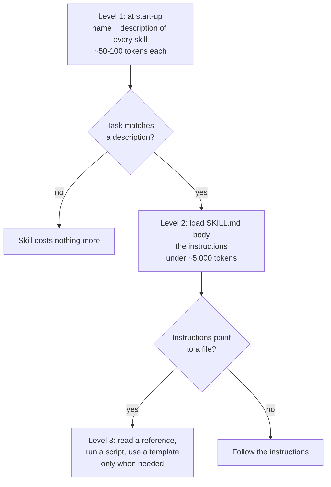

# What is an Agent Skill?: The Complete Guide

> 📚 **Before you start**
>
> - [Why Hundreds of Tool Schemas Break Agents](../03-scaling-to-many-tools/why-hundreds-of-tool-schemas-break-agents.md), where skills appeared as one of the fixes for crowded context.
> - [Code Execution: Agents that Write Code against Tools](../03-scaling-to-many-tools/code-execution-agents-that-write-code-against-tools.md), because many skills ship scripts the agent runs.
> - [Semantic, Episodic and Procedural Memory](../../context-engineering-and-agent-memory/04-memory-systems/semantic-episodic-and-procedural-memory.md), for "procedural memory": knowing *how* to do things.

## Introduction

On her first day at MandiMart's Pune office, Kavya the new finance associate gets a shared drive folder called "How we do things". It has a one-line index ("GST invoices: how to raise one, which rate applies, the template"), and behind each line a full guide, a checklist, a spreadsheet template and sometimes a small macro. She doesn't read all 40 guides on day one. She reads the index, and when a customer asks for a GST invoice, she opens that one guide and follows it.

An **agent skill** is that folder entry, for an AI agent. It's a directory containing a `SKILL.md` file: a short description of what the skill is for and when to use it, followed by instructions, and optionally scripts, reference documents and templates. The agent sees only the short descriptions of all its skills up front. When a task matches one, it loads that skill's instructions, and only reads the extra files if it needs them.

Anthropic introduced Agent Skills in October 2025 for Claude, Claude Code and the Claude API, and in December 2025 published the format as an open standard at agentskills.io. By late 2026 the same `SKILL.md` folder works in Claude Code, OpenAI Codex, Gemini CLI, GitHub Copilot, VS Code, Cursor and many other agents. This module teaches you to write skills that work in all of them.

In this lesson:

- what a skill is, with a complete small example;
- how an agent uses it, in three levels of loading;
- how skills differ from tools, prompts and memory;
- where skills came from and who supports them today.

> 💡 **Key Insight**
>
> A tool gives an agent a new **ability** (send a message, query a database). A skill gives it **know-how**: the steps, rules, templates and scripts for doing a kind of task *your* way. Because only a ~100-token description is always loaded and the rest is read on demand, an agent can carry dozens of skills without crowding its context.

---

## Core Explanation

### 1. A skill you can read in one minute

Here's a complete skill. MandiMart's store managers often ask the agent for a late-delivery report, and they want it done the same way every time.

```
late-delivery-report/
├── SKILL.md
└── scripts/
    └── late_orders.py
```

The `SKILL.md`:

```markdown
---
name: late-delivery-report
description: Builds MandiMart's daily late-delivery report for one store, with late orders, the riders involved and coupons owed. Use when a store manager asks how many orders were late, wants a late-delivery or SLA report, or asks about coupons for late orders.
---

# Late-delivery report

## When this applies
A store manager wants yesterday's (or a given day's) late deliveries for one store.
Our promise is 10 minutes from order to doorstep. An order is late if it took more than 10 minutes.

## Steps
1. Confirm the store code (like PNQ-07 for Kothrud) and the date. Default to yesterday, IST.
2. Run `python scripts/late_orders.py --store <CODE> --date <YYYY-MM-DD>`. It prints JSON.
3. Report: total orders, late orders, late percentage, the 3 worst delays, and coupons owed
   at Rs 20 per late order.
4. Do NOT issue coupons yourself. Say the coupons are ready for the manager to approve.

## Format
A short summary line, then a table: order ID, minutes taken, rider.
Write percentages with one decimal place (e.g. 42.5%).
```

That's it. Two fields of YAML **frontmatter** (the block between the `---` lines): a `name` and a `description`. Then ordinary Markdown instructions, written the way you'd brief a capable new colleague. And a script the instructions tell the agent to run, which is far more reliable than asking a model to do arithmetic over 40 orders.

### 2. How an agent uses it: three levels

Skills are loaded in stages, so an agent can have many installed while paying for very few. This is called **progressive disclosure**.



Let's measure what that means for the example above. We'll parse the frontmatter ourselves; it's simple enough that we don't need a YAML library.

```python
import math

def approx_tokens(text):
    return math.ceil(len(text) / 4)

SKILL_MD = """---
name: late-delivery-report
description: Builds MandiMart's daily late-delivery report for one store, with late orders, the riders involved and coupons owed. Use when a store manager asks how many orders were late, wants a late-delivery or SLA report, or asks about coupons for late orders.
---

# Late-delivery report

## When this applies
A store manager wants yesterday's (or a given day's) late deliveries for one store.
Our promise is 10 minutes from order to doorstep. An order is late if it took more than 10 minutes.

## Steps
1. Confirm the store code (like PNQ-07 for Kothrud) and the date. Default to yesterday, IST.
2. Run `python scripts/late_orders.py --store <CODE> --date <YYYY-MM-DD>`. It prints JSON.
3. Report: total orders, late orders, late percentage, the 3 worst delays, and coupons owed
   at Rs 20 per late order.
4. Do NOT issue coupons yourself. Say the coupons are ready for the manager to approve.

## Format
A short summary line, then a table: order ID, minutes taken, rider.
Write percentages with one decimal place (e.g. 42.5%).
"""

def split_skill(text):
    """Return (frontmatter dict, body) for a SKILL.md with simple key: value frontmatter."""
    _, front, body = text.split("---\n", 2)
    meta = {}
    for line in front.strip().splitlines():
        key, _, value = line.partition(":")
        meta[key.strip()] = value.strip()
    return meta, body.strip()

meta, body = split_skill(SKILL_MD)
print("name:", meta["name"])
print("level 1 (always loaded):", approx_tokens(meta["name"] + meta["description"]), "tokens")
print("level 2 (when used):    ", approx_tokens(body), "tokens")
```

Output:

```
name: late-delivery-report
level 1 (always loaded): 68 tokens
level 2 (when used):     191 tokens
```

About 70 tokens always, about 190 more only when a manager actually asks for the report. Now imagine 30 such skills: about 2,000 tokens of descriptions in every conversation, and full instructions only for the one or two that apply. Compare that with pasting all 30 guides into the system prompt.

```python
skills = 30
always = skills * approx_tokens(meta["name"] + meta["description"])
everything = skills * approx_tokens(SKILL_MD)
print(f"{skills} skills: {always:,} tokens up front with skills, {everything:,} if all pasted into the prompt")
```

Output:

```
30 skills: 2,040 tokens up front with skills, 7,980 if all pasted into the prompt
```

And real skills are often much longer than ours, with reference files of thousands of lines that cost nothing until read. That's the same idea as deferred tool loading from Module 3, applied to know-how.

### 3. Skills, tools, prompts and memory

It's easy to mix these up. Each answers a different question:

| | Answers | Example | Always in context? |
|---|---|---|---|
| **Tool** | "What *can* the agent do?" | `mandimart_coupons_issue(order_id, amount)` | Definition yes (unless deferred) |
| **Skill** | "How should it do this *kind of task*?" | The late-delivery report procedure, with its script | Only the description |
| **System prompt** | "Who is it and what always applies?" | "You are MandiMart's ops agent. Always use IST." | Yes, all of it |
| **MCP server** | "How does it connect to an outside system?" | Razorpay's MCP server offering refund tools | Its tools' definitions |
| **Memory** | "What does it know about this user or past work?" | "Kavya prefers reports in Hindi" | Retrieved when relevant |

In the memory course, **procedural memory** meant knowing *how* to do things, as opposed to facts (semantic) or past events (episodic). Skills are the most practical form of procedural memory today: written down, versioned in git, reviewed by humans, and loaded when needed.

Skills and tools also work together. A skill often *uses* tools: the report skill could call `mandimart_orders_search` through MCP instead of running a script. The skill adds the judgement: which tool, in what order, with which checks, and how to present the result.

### 4. What goes in a skill

Good candidates are tasks that are **repeated**, **specific to your organisation**, and **easy to get subtly wrong**:

- **Procedures**: how MandiMart raises a GST invoice, closes the day's cash at a dark store, or escalates a food-safety complaint.
- **Formats and house style**: the weekly ops review deck, the format of a refund email, brand colours and tone.
- **Domain rules**: which GST rate applies to which item category, which refunds need a manager's approval.
- **Deterministic helpers**: a script that validates a GSTIN, converts a Tally export, or calculates late deliveries exactly.
- **Tool playbooks**: "to debug a failed payment, first check Razorpay, then the order, then the ledger".

Poor candidates: one-off tasks (just ask), facts that change daily (use a tool or retrieval), and things every conversation needs (put them in the system prompt or an `AGENTS.md` file).


*One folder, three levels of loading, many agents.*

### 5. Where skills came from, and who supports them

- **October 2025**: Anthropic launched Agent Skills across Claude apps, Claude Code and the Claude API, with an engineering post on equipping agents for the real world. It shipped ready-made skills for Word, Excel, PowerPoint and PDF files, which is how Claude creates those documents.
- **December 2025**: Anthropic published the format as an open specification at **agentskills.io**, with a reference validator (`skills-ref`). The format stayed deliberately small: a folder, a `SKILL.md`, two required fields.
- **2026**: adoption spread quickly. OpenAI's Codex (CLI, IDE and app) and ChatGPT, Google's Gemini CLI, GitHub Copilot and VS Code, Cursor, OpenCode, OpenHands, Goose, Amp, Factory, Kiro, Roo Code, JetBrains' Junie, Letta, Spring AI, Databricks and Snowflake's coding agents are among the products that load `SKILL.md` folders.

Because the format is shared, a skill your team writes once can travel: from a developer's Claude Code to a colleague's Codex, to an API-based support agent. The products differ in *where* they look for skills and in optional extras, which the next lessons cover. The core folder is the same.

### 6. What a skill is not

- **Not code that runs by itself.** A skill is instructions plus files. The agent decides when to use it and does the work with its own tools (reading files, running scripts).
- **Not a security boundary.** A skill can tell the agent to "never issue coupons", and the agent will usually comply, but enforcement belongs in tools and bridges, as in Module 3's lab. Treat skill instructions as guidance.
- **Not automatically trusted.** A skill from the internet can contain harmful instructions or scripts. Installing one is like installing software: read it first. The testing and sharing lesson covers this.

---

## Try It Yourself

1. **Spot the parts.** In the late-delivery skill, which lines are level 1, which are level 2, and what is level 3?
2. **Write a description.** Write a `description` for a skill that drafts replies to customer complaints about damaged items, in MandiMart's tone. Keep it under 300 characters and say both *what* it does and *when* to use it. Check its length and token cost with Python.
3. **Skill or not?** Decide for each: (a) "Our office address for invoices"; (b) "How to reconcile Razorpay settlements with the bank statement each Monday"; (c) "Today's onion price at the Kothrud store"; (d) "Always reply in the customer's language".

<details>
<summary>Show answers</summary>

**1.** Level 1 is the frontmatter's `name` and `description`. Level 2 is everything after the second `---`: the instructions. Level 3 is `scripts/late_orders.py`, which the agent runs only when following step 2 (and never needs to read into context; it just runs it and reads the JSON output).

**2.**

```python
desc = ("Drafts replies to MandiMart customers who received damaged or spoiled items, in our warm, "
        "brief tone with the right refund or replacement offer. Use when a customer complains about "
        "broken, leaking, squashed or spoiled products.")
print(len(desc), "characters,", approx_tokens(desc), "tokens")
```

Output:

```
227 characters, 57 tokens
```

It names the task, the house tone, the outcome, and the words customers actually use ("broken, leaking, squashed"), which helps the agent match it. The lesson on writing descriptions, later in this module, is about tuning this.

**3.** (a) Not a skill: a fact needed often; put it in the system prompt or a reference file inside an invoicing skill. (b) A good skill: repeated, specific, easy to get wrong, and likely to include a script. (c) Not a skill: it changes daily; use a tool. (d) Not a skill: it applies to every conversation; put it in the system prompt or `AGENTS.md`.

</details>

---

## Real-World Examples

- **Claude's document skills**: when Claude creates a PowerPoint or Excel file, it loads Anthropic's `pptx` or `xlsx` skill, whose instructions and scripts encode how to build valid Office files.
- **Codex's built-in `$skill-creator` and `$skill-installer`** let developers make and install skills from inside the agent, and Codex discovers team skills from `.agents/skills` folders in a repository.
- **Companies' brand and compliance skills**: teams package brand guidelines, legal review checklists or incident runbooks as skills, so every agent in the company applies them the same way.
- **Open skill collections** such as Anthropic's public `anthropics/skills` repository on GitHub provide examples for documents, design, testing web apps and creating new skills.

---

## Common Misconceptions

### "A skill is just a long prompt"

The instructions are prompt text, but the format adds two things a prompt doesn't have: on-demand loading through the description, and bundled files (scripts, references, templates) the agent can run or read only when needed.

### "Skills replace tools and MCP"

They complement them. Tools and MCP give access to systems; skills teach the procedure and judgement for using them. Many skills tell the agent which tools to call.

### "More skills always make an agent better"

Each skill adds a description to every conversation, and overlapping descriptions confuse the choice, just like look-alike tools. Keep skills focused and distinct.

### "Skills only work with Claude"

They started at Anthropic, but the format is an open standard supported by most major coding agents and several agent frameworks.

---

## Interview Relevance

*"What are Agent Skills and why do they matter?"* A skill is a folder with a `SKILL.md` (YAML frontmatter with `name` and `description`, then Markdown instructions) plus optional scripts, references and assets. Agents load skills by progressive disclosure: descriptions always (about 100 tokens each), instructions when a task matches, files only when needed. That lets an agent carry many procedures cheaply. Distinguish skills (know-how) from tools (abilities), MCP (connections), system prompts (always-on rules) and memory (facts about users and history). Mention that it's an open standard (agentskills.io, December 2025) supported by Claude, Codex, Gemini CLI, Copilot, Cursor and others.

Follow-up: *"When wouldn't you use a skill?"* For facts that change often (tools or retrieval), rules every conversation needs (system prompt or AGENTS.md), and hard limits (enforce them in tools).

---

## Key Takeaways

- **A skill is a folder with a `SKILL.md`**: a name and description in frontmatter, instructions below, optional scripts, references and assets.
- **Skills give know-how; tools give abilities.** Skills often tell the agent which tools to use and how.
- **Progressive disclosure keeps them cheap**: descriptions always, instructions on match, files on demand.
- **It's an open standard** used by Claude, Codex, Gemini CLI, Copilot, Cursor and many more, so skills travel between agents.
- **Skills guide; they don't enforce.** Hard limits stay in tools, and third-party skills need review like any software.

---

**Up next:** [Anatomy of a Skill Folder and SKILL.md](anatomy-of-a-skill-folder-and-skill-md.md)
