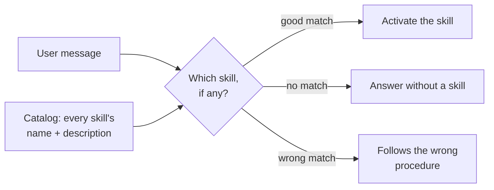
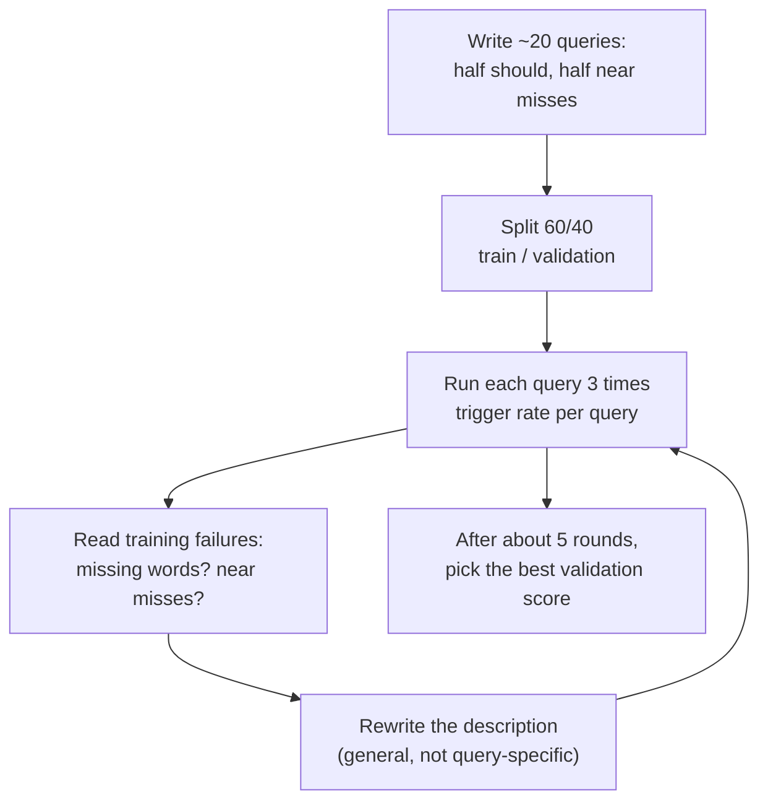

# Writing Descriptions that Trigger Correctly: The Complete Guide

> 📚 **Before you start**
>
> - [Progressive Disclosure: Discovery, Activation, Execution](progressive-disclosure-discovery-activation-execution.md), for the catalog where descriptions appear and how activation works.
> - [Evaluating Tools with an Agent in the Loop](../02-writing-tools-for-agents/evaluating-tools-with-an-agent-in-the-loop.md): this lesson applies the same measure-and-iterate loop to skill descriptions.

## Introduction

A signboard outside a shop in Laxmi Road decides who walks in. "Shri Ganesh Enterprises" tells you nothing. "Mobile repair: screens, batteries, water damage. While-you-wait" brings in exactly the right customers, and keeps out people looking for a new phone.

A skill's `description` is its signboard. It's the only thing the model sees before deciding whether to load the skill, so it decides two things:

- **Recall**: does the skill trigger when it should? A skill that never loads is useless, however good its instructions.
- **Precision**: does it stay quiet when it shouldn't? A skill that loads for the wrong tasks wastes tokens and, worse, makes the agent follow the wrong procedure.

This lesson covers how to write descriptions that do both, and, more importantly, how to **test** them, following the method in the Agent Skills specification's guide to optimising descriptions: a set of should-trigger and should-not-trigger queries, several runs each, a train/validation split, and a few rounds of improvement.

> 💡 **Key Insight**
>
> Write the description for the **moment of decision**: a model reading one line among many, with a user's message in front of it. Say what the skill does, then list the **words users actually use** when they need it, and name the **near misses** it's not for. Then measure trigger rates on realistic queries, because your intuition about what triggers is often wrong.

---

## Core Explanation

### 1. What the model is deciding

When a message arrives, the model sees the catalog (name and description of every skill) and the user's words. It has to decide: does any skill apply, and which one? Two facts shape how to write for that moment:

- **Models tend to under-trigger.** For tasks they think they can handle alone ("what's the GST on this?"), they often skip the skill, even when the skill has the company's exact procedure. The specification's guide recommends being a little "pushy": state plainly the situations where the skill should be used.
- **Descriptions compete.** Your skill's description sits next to others. If two describe overlapping territory, the model must guess between them, the same look-alike problem tools have.



### 2. Five rules for descriptions

1. **Lead with what it does, as an outcome.** "Prepares GST tax invoices for MandiMart orders" beats "Invoice helper".
2. **Then say when to use it, in users' words.** "Use when someone asks for an invoice, tax invoice, B2B bill, input tax credit, or how much tax is on an order." Include synonyms and the informal ways people ask ("bill", "tax breakup").
3. **Name the near misses.** "Not for GST returns, GSTR filing, tax payable totals or general questions about GST rules." This is what keeps precision high when neighbouring skills or general questions share vocabulary.
4. **Write in the imperative, about intent, not implementation.** "Use when..." rather than "This skill uses a Python script with Decimal rounding". How it works belongs in the body.
5. **Put the trigger words early and stay concise.** Listings may be truncated, and every word is paid for in every conversation. The limit is 1,024 characters; most good descriptions are 200 to 500.

Here are three versions of the `gst-invoice` description we'll test:

```python
VERSIONS = {
    "v1": "Helps with invoices.",
    "v2": ("Prepares GST tax invoices for MandiMart orders with CGST, SGST or IGST. Use when someone asks "
           "for a GST invoice, tax invoice, bill or GST details."),
    "v3": ("Prepares GST tax invoices and bills for MandiMart orders, with the CGST/SGST or IGST tax breakup "
           "and the buyer's GSTIN. Use when someone asks for an invoice, tax invoice, B2B bill, input tax "
           "credit, or how much tax is on an order or bill. Not for GST returns, GSTR filing, tax payable "
           "totals, refunds, or general questions about GST rules."),
}
for name, d in VERSIONS.items():
    print(name, len(d), "characters")
```

Output:

```
v1 20 characters
v2 146 characters
v3 339 characters
```

### 3. The test set

The method needs realistic queries of two kinds, about 20 in total:

- **Should trigger** (8 to 10): the many ways people ask for the skill's job, including indirect ones that never say "invoice".
- **Should not trigger** (8 to 10): mostly **near misses**, queries that share vocabulary but need something else (a GST *return*, a *refund* of an invoice amount), plus a few clear negatives.

```python
SHOULD = [
    "Can you make a GST invoice for order MM-48213?",
    "Cafe Malabar needs a tax invoice for yesterday's bulk order",
    "what's the CGST and SGST on this order",
    "B2B bill for Hotel Sai Palace, their GSTIN is 27AAACH1234K1Z2",
    "customer wants the GST breakup for order MM-48250",
    "need an invoice with IGST since the buyer is in Bengaluru",
    "prepare the bill with tax details for the Koregaon Park restaurant order",
    "they need a proper invoice to claim input tax credit",
    "how much tax goes on this bill of 24 colas",
    "redo the invoice, the GSTIN on it was wrong",
]
SHOULD_NOT = [
    "send the refund email for order MM-48213",
    "how many orders were late at Kothrud yesterday",
    "what's our total GST payable this quarter?",
    "explain what GST 2.0 changed in September 2025",
    "export last month's sales report to Excel",
    "file the GSTR-1 return for September",
    "the customer says the invoice amount was charged twice on UPI",
    "update the price of Amul butter in the catalogue",
    "write a polite reply to a customer complaining about a damaged egg tray",
    "what is a GSTIN?",
]
QUERIES = [(q, True) for q in SHOULD] + [(q, False) for q in SHOULD_NOT]

# 60/40 split: tune on train, judge on validation (positions 1 and 3 of every 5 go to validation)
TRAIN = [qs for i, qs in enumerate(QUERIES) if i % 5 not in (1, 3)]
VALID = [qs for i, qs in enumerate(QUERIES) if i % 5 in (1, 3)]
print(len(TRAIN), "train,", len(VALID), "validation,",
      sum(s for _, s in VALID), "of the validation queries should trigger")
```

Output:

```
12 train, 8 validation, 4 of the validation queries should trigger
```

Why a split? If you rewrite the description until it passes every query you can see, you'll overfit: the description will contain those exact phrases and fail on the next user's wording. So you tune against the training queries and only check the validation queries to choose between versions.

### 4. A pretend model that chooses skills

To run the method offline, we need something that picks skills from a catalog the way a model roughly does. Our stand-in:

- scores each skill by the query words found in its description, with **rare words counting more** (a word that appears in only one description, like "gstin", is strong evidence);
- treats words in a **"Not for ..."** clause as evidence *against* the skill;
- adds a little **random noise**, because real models don't give the same answer every time;
- triggers the best skill only if its score clears a threshold; otherwise no skill is used (models under-trigger).

It's a crude imitation of a model, but it's good enough to show the effects of each description change. Section 7 shows the same test with a real model.

```python
import math, random, re
from collections import Counter

STOP = set("a an the for of to and or is are be on in with this that it my our we you your can me i "
           "need what how do does when use skill asks someone".split())

def words(text):
    result = []
    for w in re.findall(r"[a-z0-9]+", text.lower()):
        if w in STOP:
            continue
        if len(w) > 3 and w.endswith("s"):      # crude singular: invoices -> invoice
            w = w[:-1]
        result.append(w)
    return result

def split_desc(desc):
    m = re.search(r"\bnot for\b(.*)", desc, re.I)
    return (desc[:m.start()], m.group(1)) if m else (desc, "")

def pretend_model_choice(query, catalog, rng, threshold=1.6, noise=0.35):
    df = Counter()
    for d in catalog.values():
        df.update(set(words(split_desc(d)[0])))
    q = set(words(query))
    scores = {}
    for name, d in catalog.items():
        positive, negative = (set(words(part)) for part in split_desc(d))
        score = sum(math.log(1 + len(catalog) / df[w]) for w in q & positive) - 1.5 * len(q & negative)
        scores[name] = score + rng.gauss(0, noise)
    best = max(scores, key=scores.get)
    return best if scores[best] >= threshold else None

OTHER_SKILLS = {
    "refund-email": "Drafts a polite refund confirmation email to a MandiMart customer. Use when asked to write "
                    "or send a refund email or message, or when a customer was charged twice.",
    "late-delivery-report": "Builds the daily late-delivery report for one store: late orders, riders and coupons "
                            "owed. Use when a store manager asks how many orders were late.",
    "sales-report": "Exports sales reports by store, month or product to Excel or CSV. Use when asked for sales "
                    "figures or a sales export.",
    "complaint-reply": "Writes replies to customer complaints about damaged, spoiled or missing items in "
                       "MandiMart's tone.",
    "catalogue-update": "Updates product prices, names and stock in the MandiMart catalogue.",
}
catalog = dict(OTHER_SKILLS, **{"gst-invoice": VERSIONS["v2"]})
print(pretend_model_choice("Can you make a GST invoice for order MM-48213?", catalog, random.Random(0)))
print(pretend_model_choice("send the refund email for order MM-48213", catalog, random.Random(0)))
```

Output:

```
gst-invoice
refund-email
```

### 5. Trigger rates over several runs

Because models vary run to run, the method runs **each query several times (3 is typical)** and computes a **trigger rate**: the fraction of runs in which the skill was activated. A should-trigger query passes if its rate is at least 0.5; a should-not-trigger query passes if its rate is below 0.5.

```python
def trigger_rate(query, description, runs=3, skill="gst-invoice"):
    catalog = dict(OTHER_SKILLS, **{skill: description})
    hits = sum(pretend_model_choice(query, catalog, random.Random(1000 * r + len(query))) == skill
               for r in range(runs))
    return hits / runs

def score(description, queries):
    passed, failures = 0, []
    for q, should in queries:
        rate = trigger_rate(q, description)
        ok = (rate >= 0.5) == should
        passed += ok
        if not ok:
            failures.append((round(rate, 2), "should" if should else "should NOT", q))
    return passed, failures

for name, desc in VERSIONS.items():
    tr, _ = score(desc, TRAIN)
    va, _ = score(desc, VALID)
    print(f"{name}: train {tr}/{len(TRAIN)}  validation {va}/{len(VALID)}")
```

Output:

```
v1: train 9/12  validation 4/8
v2: train 10/12  validation 7/8
v3: train 11/12  validation 8/8
```

Now read the failures, the way Module 2 taught you to read transcripts. Start with v1 on the training set:

```python
for rate, kind, q in score(VERSIONS["v1"], TRAIN)[1]:
    print(f"rate {rate:<5} {kind:<10} trigger: {q}")
```

Output:

```
rate 0.0   should     trigger: what's the CGST and SGST on this order
rate 0.0   should     trigger: customer wants the GST breakup for order MM-48250
rate 0.33  should     trigger: redo the invoice, the GSTIN on it was wrong
```

"Helps with invoices" only matches queries containing the word "invoice". Requests phrased as "CGST and SGST" or "GST breakup" are missed, and even "redo the invoice" triggers only one run in three because the description gives the model so little to go on. (On the validation set it does worse: 4 of 8.) That's the classic under-triggering description: technically accurate, practically invisible.

Version 2 lists more of those words. What does it get wrong?

```python
for rate, kind, q in score(VERSIONS["v2"], QUERIES)[1]:
    print(f"rate {rate:<5} {kind:<10} trigger: {q}")
```

Output:

```
rate 0.33  should     trigger: redo the invoice, the GSTIN on it was wrong
rate 0.67  should NOT trigger: what's our total GST payable this quarter?
rate 1.0   should NOT trigger: explain what GST 2.0 changed in September 2025
```

Now the opposite problem: near misses. "GST" in the description pulls in questions about GST payable and GST 2.0, which aren't invoice tasks. And "redo the invoice, the GSTIN was wrong" still slips through, because v2 never mentions GSTINs. Version 3 addresses both: it adds "GSTIN", "input tax credit" and "how much tax is on an order or bill", and a **"Not for..."** clause naming the near misses.

```python
for rate, kind, q in score(VERSIONS["v3"], QUERIES)[1]:
    print(f"rate {rate:<5} {kind:<10} trigger: {q}")
```

Output:

```
rate 0.67  should NOT trigger: what is a GSTIN?
```

One failure remains: "what is a GSTIN?" is a general question, but v3's description mentions GSTINs, so it triggers. Is that acceptable? Loading the skill for a definition question wastes a few hundred tokens but does no harm, so many teams would accept it. If it mattered, you'd add "definitions" to the "Not for" clause and re-check that the GSTIN-correction query still triggers.

### 6. The improvement loop

The specification's guide describes a loop you can run by hand or with a model's help:



Some practical points:

- **Fix categories, not queries.** If "bill" fails, add the *concept* ("bill, invoice, tax breakup"), not the literal failing sentence. Otherwise you overfit to the training set.
- **Choose the winner by validation score**, not training score. A version that's perfect on training but worse on validation memorised its examples.
- **About five iterations** is usually enough; after that, gains are mostly noise.
- **Re-run when neighbours change.** Adding a new skill (say, `gst-returns`) changes what's ambiguous. Keep each skill's test set and run all of them in CI.
- **Simple tasks may never trigger.** If users ask quick questions the model is confident about, it may answer directly. If your procedure *must* apply, make it explicit (the user types `/gst-invoice`) or put the rule in the system prompt.

### 7. Doing this with a real model

With a real model, the test is the same; only the "chooser" changes. Give the model a system prompt with the catalog and an `activate_skill` tool (as in the previous lesson), send each query, and check whether it calls the tool with your skill's name:

```python
# not-run: needs the anthropic package and an API key
import anthropic

client = anthropic.Anthropic()

def real_trigger_rate(query, description, runs=3):
    catalog = dict(OTHER_SKILLS, **{"gst-invoice": description})
    system = "You are MandiMart's assistant.\n<available_skills>\n" + "\n".join(
        f"<skill><name>{n}</name><description>{d}</description></skill>" for n, d in catalog.items()
    ) + "\n</available_skills>\nIf a skill matches the task, call activate_skill first."
    tool = {"name": "activate_skill", "description": "Load a skill's instructions.",
            "input_schema": {"type": "object", "properties": {"name": {"type": "string", "enum": sorted(catalog)}},
                             "required": ["name"]}}
    hits = 0
    for _ in range(runs):
        r = client.messages.create(model="claude-opus-5-5", max_tokens=512, system=system,
                                   tools=[tool], messages=[{"role": "user", "content": query}])
        hits += any(b.type == "tool_use" and b.input.get("name") == "gst-invoice" for b in r.content)
    return hits / runs

print(real_trigger_rate("customer wants the GST breakup for order MM-48250", VERSIONS["v3"]))
```

Example output:

```
1.0
```

With Claude Code you can test the real product instead: run the agent non-interactively (`claude -p "<query>" --output-format json`) in a folder containing the skill, and check its output for an invocation of the skill. Anthropic's `skill-creator` skill automates exactly this loop, including proposing new descriptions from the failures.

Each run costs money, so keep the set small (around 20 queries times 3 runs is 60 calls per version) and cache results for unchanged descriptions.

---

## Try It Yourself

1. **Fix the last miss.** Write a `v4` that adds "definitions such as what a GSTIN is" to the "Not for" clause. Does "what is a GSTIN?" stop triggering? Does "redo the invoice, the GSTIN on it was wrong" still trigger?
2. **A new neighbour.** Add a skill `gst-returns` with description "Prepares GSTR-1 and GSTR-3B monthly GST returns and the tax payable summary. Use when asked to file or prepare GST returns." to `OTHER_SKILLS`, and re-score v2 and v3 on all queries. What changes?
3. **Write a test set.** For the `late-delivery-report` skill, write 4 should-trigger and 4 should-not queries (at least 3 near misses), and score its current description with `score()` (pass `skill="late-delivery-report"` through by writing a small variant of `trigger_rate`).

<details>
<summary>Show answers</summary>

**1.**

```python
VERSIONS["v4"] = VERSIONS["v3"].replace("or general questions about GST rules.",
                                        "general questions about GST rules, or definitions such as what a GSTIN is.")
print(score(VERSIONS["v4"], QUERIES)[1])
print("train", score(VERSIONS["v4"], TRAIN)[0], "| validation", score(VERSIONS["v4"], VALID)[0])
```

Output:

```
[(0.33, 'should', 'redo the invoice, the GSTIN on it was wrong')]
train 11 | validation 8
```

The definition question no longer triggers, but now the GSTIN-correction request fails: putting "GSTIN" in the "Not for" clause counts against every query that mentions a GSTIN. The scores tie (11 train, 8 validation), so the split doesn't separate them; you'd pick v3, because wrongly loading the skill for a definition is cheap while missing a real invoice correction is not. A fix that trades one failure for another is common; always re-score everything before adopting it.

**2.**

```python
OTHER_SKILLS["gst-returns"] = ("Prepares GSTR-1 and GSTR-3B monthly GST returns and the tax payable summary. "
                               "Use when asked to file or prepare GST returns.")
for name in ["v2", "v3"]:
    passed, failures = score(VERSIONS[name], QUERIES)
    print(name, f"{passed}/{len(QUERIES)}", [f[2] for f in failures])
del OTHER_SKILLS["gst-returns"]
```

Output:

```
v2 20/20 []
v3 19/20 ['what is a GSTIN?']
```

A neighbour that owns "returns" and "tax payable" takes those near misses away from the invoice skill, so even v2 does better. Descriptions are judged as a set: whenever you add a skill, re-run every skill's tests.

**3.**

```python
def trigger_rate_for(query, description, skill, runs=3):
    catalog = dict(OTHER_SKILLS, **{skill: description})
    return sum(pretend_model_choice(query, catalog, random.Random(1000 * r + len(query))) == skill
               for r in range(runs)) / runs

late_desc = OTHER_SKILLS["late-delivery-report"]
late_queries = [("how many orders were late at Baner yesterday", True),
                ("SLA report for Kothrud for 15 October", True),
                ("which riders were slow on Saturday", True),
                ("how many coupons do we owe for late deliveries", True),
                ("issue a Rs 20 coupon to Priya", False),
                ("what's the status of order MM-48250", False),
                ("export Kothrud's October sales", False),
                ("a customer complained that her order came late and the eggs were broken", False)]
others = {k: v for k, v in OTHER_SKILLS.items() if k != "late-delivery-report"}
saved = OTHER_SKILLS
OTHER_SKILLS = others
for q, should in late_queries:
    rate = trigger_rate_for(q, late_desc, "late-delivery-report")
    print("PASS" if (rate >= 0.5) == should else "FAIL", round(rate, 2), q)
OTHER_SKILLS = saved
```

Output:

```
PASS 1.0 how many orders were late at Baner yesterday
FAIL 0.0 SLA report for Kothrud for 15 October
PASS 1.0 which riders were slow on Saturday
PASS 1.0 how many coupons do we owe for late deliveries
PASS 0.33 issue a Rs 20 coupon to Priya
PASS 0.33 what's the status of order MM-48250
PASS 0.0 export Kothrud's October sales
FAIL 1.0 a customer complained that her order came late and the eggs were broken
```

Two failures to read. "SLA report" never triggers because the description doesn't contain "SLA" (users say SLA, delayed, slow). And a complaint about one late order triggers the report skill, because "late" and "order" match; it belongs to the complaint skill, so the description needs a "Not for complaints about a single order" clause.

</details>

---

## Real-World Examples

- **Anthropic's `skill-creator` skill** includes a description-optimisation workflow: it generates should and should-not queries, runs them several times, splits train and validation, and proposes improved descriptions.
- **Claude Code** truncates the combined description and `when_to_use` text of each skill in its listing at 1,536 characters, one reason to put trigger words first.
- **Codex** lets teams mark a skill explicit-only (`allow_implicit_invocation: false`) when a description can't be made precise enough to trust automatic triggering, such as for deployment skills.
- **Teams with large skill libraries** keep a trigger test set per skill in the repository and run it in CI, the same way they run unit tests.

---

## Common Misconceptions

### "The description should explain how the skill works"

The model needs to know *when* to use it, not how. Implementation details waste the description's tokens; put them in the body.

### "If it triggers on my three test prompts, it's done"

Three prompts can't show near-miss behaviour or run-to-run variation. Use around 20 realistic queries, half of them near misses, with several runs each.

### "Longer descriptions trigger better"

More relevant words help, but long, vague descriptions overlap with neighbours and cost tokens everywhere. Specific beats long.

### "A negative clause is unnecessary because models understand intent"

Models do weigh intent, but shared vocabulary still pulls them toward the wrong skill. Naming near misses explicitly is one of the most effective precision fixes.

---

## Interview Relevance

*"How do you make sure a skill is used when it should be?"* Describe writing the description as what plus when, in users' words, with near misses excluded, imperative and concise. Then the evaluation: about 20 queries split between should-trigger and near-miss should-not-trigger, each run about 3 times for a trigger rate with a 0.5 threshold, a 60/40 train/validation split, iterating on general concepts for about five rounds and picking by validation score; re-run when other skills change; use explicit invocation for skills that must or must never run automatically.

Follow-up: *"Why do skills under-trigger?"* Models skip skills for tasks they believe are simple, and vague descriptions don't match how users phrase requests.

---

## Key Takeaways

- **The description decides recall and precision**: it's the only part of the skill the model sees before choosing.
- **Write what it does, when to use it in users' words, and what it's not for**, with trigger words early.
- **Test with about 20 realistic queries**, half near misses, 3 runs each, and a trigger-rate threshold of 0.5.
- **Tune on training queries, choose on validation**, and fix concepts rather than specific failing sentences.
- **Re-test whenever neighbouring skills change**, and use explicit invocation when automatic triggering isn't reliable enough.

---

**Up next:** [Bundling Scripts and Reference Files](../course.md#m4)
