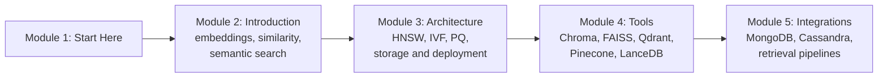

# How This Course Works

## Introduction

Open a food delivery app and type *"something light, not oily, for a rainy evening"*. No dish on the menu contains those exact words, yet a good app still suggests idli, soup and steamed momos. Ask a company chatbot *"how do I get my money back for a cancelled trip?"* and it finds the policy page titled **"Refunds for travel bookings"**, even though you never typed "refund" or "booking".

Neither of these works by matching words. They work by matching **meaning**. The text is turned into a list of numbers, called an **embedding**, and the system looks for stored items whose numbers are closest to the numbers of your question. The software that stores millions of these number lists and finds the closest ones in milliseconds is a **vector database**.

Vector databases sit underneath almost every modern AI product that "knows your documents": retrieval-augmented generation (RAG), semantic search, recommendations, duplicate detection and agent memory. This course takes you from "what is an embedding?" to choosing, tuning and running a vector database in production.

This first article is short. It tells you what you will learn, how the lessons are built, what you should know before starting, and how to get the most out of the course.

> 💡 **Key Insight**
>
> A vector database does **one** new thing that ordinary databases did not: it answers *"which stored items are most similar to this one?"* fast, over millions of items. Everything else in this course (embeddings, distance measures, HNSW, IVF, quantization, filters, the products themselves) is either the input to that question or a clever way to answer it quickly.

---

## What You Will Learn

By the end of this course you will be able to:

- **Read an embedding vector** and explain what its numbers mean, how many there are and where they come from.
- **Compute similarity yourself** with NumPy: dot product, cosine similarity and Euclidean distance, and know which one to use when.
- **Build semantic search from scratch** in about twenty lines of Python, then explain why it stops being enough at scale.
- **Explain the index families** every vector database uses: flat search, IVF, HNSW and product quantization (PQ), including the recall, speed and memory trade-offs between them. You will build a small version of each in NumPy.
- **Choose a deployment style**: in-memory library, embedded database, self-hosted server or managed cloud service.
- **Use the main tools**: Chroma, FAISS, Qdrant, Pinecone and LanceDB, plus vector search inside MongoDB and Cassandra (and PostgreSQL with pgvector).
- **Build a full retrieval pipeline**: loading, chunking, embedding, storing, filtering, searching and evaluating it with recall.

### The course at a glance

| Module | The question it answers |
|---|---|
| **2. Introduction to Vector Databases** | What is an embedding, how do we measure "similar", and why do we need a new kind of database? |
| **3. Architecture** | How does a vector database find the nearest items without comparing against all of them, and where does the data live? |
| **4. Tools** | What do the popular vector stores look like in code, and when should you pick each one? |
| **5. Integrations** | How do vectors fit into databases you already run, and how do you build a complete retrieval pipeline around them? |

After this course comes [Retrieval-Augmented Generation (RAG)](../../retrieval-augmented-generation-rag/course.md), which plugs everything you build here into a language model.

---

## How Every Lesson Is Built

Every article follows the same shape, so you always know where to look:

| Section | What it gives you |
|---|---|
| **Before you start** | Links to the earlier lessons this one depends on. |
| **Introduction** | Why the topic matters, with an everyday example. |
| **Key Insight** | The one idea to remember if you remember nothing else. |
| **Core Explanation** | The topic step by step, with diagrams, tables and runnable code. |
| **Try It Yourself** | Exercises, with answers hidden in a fold. |
| **Real-World Examples** | Where real products use the idea. |
| **Common Misconceptions** | Mistakes almost everyone makes, corrected. |
| **Interview Relevance** | What interviewers ask and what a strong answer covers. |
| **Key Takeaways** | A one-minute summary. |

**Labs** are guided builds. You start from an empty file and finish with something that works. The two labs in this course are where the ideas stick: one runs the same search in three different vector stores, and the other builds semantic search over your own notes.

### About the code

Every Python example marked with an `Output:` block **really runs**, and the output shown is what it printed. The examples use only **NumPy**, **pandas**, **scikit-learn** and the standard library, so they run on any laptop with no API key and no downloads.

That has one consequence worth knowing up front. Real embedding models (the ones that turn text into vectors) are large downloads or paid APIs, so the runnable lessons use either:

- a **tiny hand-made embedding model** with six readable dimensions (food, cricket, money, travel, weather, tech), so you can see exactly why two sentences end up close; or
- **random vectors** with a fixed seed, when the lesson is about indexes and speed rather than meaning.

Code that needs a real product (Chroma, Qdrant, Pinecone and so on) or a real embedding model is shown in blocks marked `# not-run`, written against the current library versions, with an `Example output:` showing what you should expect. Install the package and it runs as shown.

---

## What You Need Before Starting

- **Python and NumPy basics.** Arrays, shapes, `np.dot`, slicing. [Numerical Computing and Data Analysis](../../numerical-computing-and-data-analysis/course.md) covers this.
- **What a word embedding is**, at least roughly. [NLP for Machine Learning › Word Embeddings](../../nlp-for-machine-learning/course.md#m5) explains word vectors and Word2Vec. The first lesson here recaps what you need.
- **Basic database ideas.** Tables, rows, queries and indexes. [Databases: SQL and NoSQL](../../databases-sql-and-nosql/course.md) covers this.
- **A rough idea of what an LLM is.** [Generative AI and LLM Foundations](../../generative-ai-and-llm-foundations/course.md) covers it.

You do **not** need linear algebra beyond "a vector is a list of numbers" and "a dot product multiplies matching numbers and adds them up". The lessons explain every formula they use.

---

## How to Get the Most Out of It

1. **Run the NumPy examples and change the numbers.** Similarity only becomes intuitive when you have nudged a vector and watched the score move.
2. **Predict before you run.** Before an index example prints its recall, guess it. You will soon develop a feel for the trade-offs.
3. **Do the exercises.** Several of them are the exact questions interviewers ask, such as "why does IVF miss results?" or "when is cosine the same as dot product?".
4. **Build the labs with a real tool.** Install at least one vector store (Chroma or Qdrant's local mode are the easiest) and run the not-run blocks yourself.

---

## Common Misconceptions

### "A vector database is only for RAG"

RAG made vector databases famous, but the same search powers product recommendations, image search, fraud and duplicate detection, music identification and long-term memory for AI agents.

### "I need a special vector database to start"

For a few thousand items, a NumPy array and one line of matrix maths are enough, and you will write exactly that in the first lessons. A database starts to earn its place when you need persistence, filters, updates, millions of vectors or many users at once.

### "The vector database understands my text"

It does not. The **embedding model** captures meaning when it turns text into numbers. The database only stores numbers and finds close ones quickly. A poor embedding model gives poor results in even the best database.

---

## Key Takeaways

- **A vector database answers "what is most similar to this?"** quickly, over very large collections.
- **Embeddings carry the meaning; the database carries the speed.** You need both to be good.
- **The course moves from ideas to tools:** embeddings and similarity, then indexes and storage, then real products, then full pipelines.
- **All runnable code uses NumPy and scikit-learn**, so you can run it anywhere; product code is shown in clearly marked blocks.

---

**Up next:** [Embeddings and Similarity Search](../02-introduction-to-vector-databases/embeddings-and-similarity-search.md)
