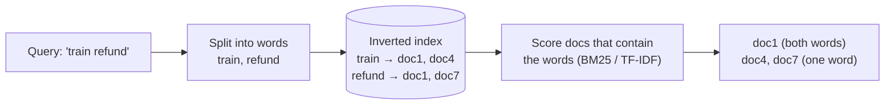
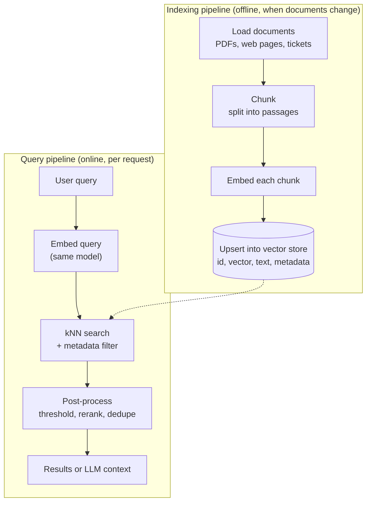
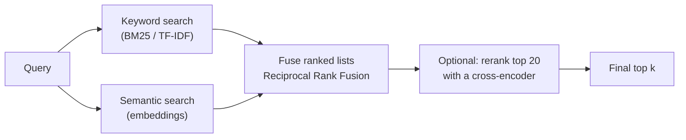

# Semantic Search Explained: The Complete Guide

> 📚 **Before you start**
>
> - [Embeddings and Similarity Search](embeddings-and-similarity-search.md), for embeddings, cosine similarity and brute-force kNN search. This lesson reuses the toy embedding model from there.
> - [NLP for Machine Learning › Text Representation](../../nlp-for-machine-learning/course.md#m4), for bag of words and TF-IDF. The lesson recaps what you need.

## Introduction

Your grandmother wants to watch "that old film where Amitabh plays an angry police officer". She types exactly that into a streaming app. A search box that matches **words** looks for titles and descriptions containing "angry", "police", "officer" and "old film", and probably shows her a 2024 cop thriller. A search box that matches **meaning** understands she wants *Zanjeer*, a 1973 film whose description may never use the word "angry" at all.

The first kind is **keyword search** (also called **lexical search**): it finds documents that contain the same words as the query. The second kind is **semantic search**: it finds documents that **mean** something similar to the query, even when they share no words. Semantic search is the most common reason people adopt a vector database, and it is the retrieval half of RAG.

By the end of this lesson you will be able to:

- explain how keyword search works and exactly where it fails;
- build keyword search (TF-IDF) and semantic search (embeddings) side by side and compare them on the same queries;
- describe the two pipelines of every semantic search system: indexing and querying;
- explain chunking, asymmetric search and score thresholds;
- combine keyword and semantic results with **hybrid search** (Reciprocal Rank Fusion);
- measure a search system with recall@k and MRR instead of eyeballing it.

> 💡 **Key Insight**
>
> Keyword search asks *"which documents contain these words?"*. Semantic search asks *"which documents are about the same thing?"*. Each one fails exactly where the other succeeds: semantic search misses exact codes and names, keyword search misses synonyms and paraphrases. **Production systems use both** and merge the results.

---

## Core Explanation

### 1. Keyword search in one paragraph

Classic search engines build an **inverted index**: a table from each word to the list of documents containing it, like the index at the back of a textbook. To answer a query, they look up each query word, collect the documents, and score them. The most famous scoring formulas, **TF-IDF** and **BM25**, reward documents that contain the query words often (term frequency) and give more weight to rare words than common ones (inverse document frequency). "Refund" in a query matters more than "the".



Keyword search is fast, cheap, explainable ("this document matched because it contains *refund*") and excellent at **exact** things: product codes, PNR numbers, error messages, names. Its weakness is the **vocabulary mismatch problem**: people describe the same thing with different words.

### 2. Two searches, same documents

Let's build both kinds of search over the same small help-centre collection and ask them the same questions. For keyword search we use scikit-learn's `TfidfVectorizer`, which turns each document into a sparse vector of word weights. For semantic search we use the toy six-dimension embedding model from [Embeddings and Similarity Search](embeddings-and-similarity-search.md) (food, cricket, money, travel, weather, tech), with a few more words added.

```python
import re
import numpy as np
from sklearn.feature_extraction.text import TfidfVectorizer

DIMS = ["food", "cricket", "money", "travel", "weather", "tech"]
LEXICON = {
    "chai": (0.9, 0, 0, 0, 0.1, 0), "tea": (0.9, 0, 0, 0, 0.1, 0), "samosa": (1, 0, 0, 0, 0, 0),
    "biryani": (1, 0, 0, 0, 0, 0), "recipe": (0.9, 0, 0, 0, 0, 0.1), "spicy": (0.8, 0, 0, 0, 0.1, 0),
    "dinner": (0.9, 0, 0.1, 0, 0, 0), "eat": (1, 0, 0, 0, 0, 0), "meal": (0.9, 0, 0, 0.1, 0, 0), "food": (1, 0, 0, 0, 0, 0),
    "cricket": (0, 1, 0, 0, 0, 0), "match": (0, 0.8, 0, 0, 0, 0.1), "stadium": (0, 0.8, 0, 0.2, 0, 0),
    "upi": (0, 0, 0.9, 0, 0, 0.4), "payment": (0, 0, 1, 0, 0, 0.1), "refund": (0, 0, 1, 0.1, 0, 0),
    "money": (0, 0, 1, 0, 0, 0), "rupees": (0, 0, 1, 0, 0, 0), "debited": (0, 0, 1, 0, 0, 0.1),
    "failed": (0, 0.1, 0.3, 0, 0, 0.3), "charged": (0, 0, 0.9, 0, 0, 0),
    "train": (0, 0, 0, 1, 0, 0), "ticket": (0, 0.1, 0.3, 0.8, 0, 0), "irctc": (0, 0, 0.2, 0.9, 0, 0.2),
    "flight": (0, 0, 0.1, 1, 0, 0), "cancelled": (0, 0.1, 0.2, 0.5, 0.1, 0), "trip": (0, 0, 0, 1, 0, 0),
    "booking": (0, 0, 0.3, 0.8, 0, 0.1), "pnr": (0, 0, 0, 0.9, 0, 0.1), "journey": (0, 0, 0, 1, 0, 0),
    "rain": (0, 0.1, 0, 0.1, 0.9, 0), "monsoon": (0, 0, 0, 0.1, 1, 0), "rainy": (0, 0, 0, 0, 1, 0),
    "app": (0, 0, 0.1, 0, 0, 1), "phone": (0, 0, 0.1, 0, 0, 1), "crash": (0, 0, 0, 0, 0, 1),
    "crashing": (0, 0, 0, 0, 0, 1), "login": (0, 0, 0, 0, 0, 1), "password": (0, 0, 0, 0, 0, 1),
}

def embed(text):
    words = re.findall(r"[a-z]+", text.lower())
    vectors = [LEXICON[w] for w in words if w in LEXICON]
    v = np.sum(vectors, axis=0) if vectors else np.zeros(len(DIMS))
    length = np.linalg.norm(v)
    return v / length if length else v

docs = [
    "How to get a refund for a cancelled IRCTC train ticket",
    "Money debited but UPI payment failed: what to do",
    "Flight booking cancelled by the airline",
    "Resetting your password when you cannot login",
    "Why the app keeps crashing on your phone",
    "Ordering dinner: spicy biryani and samosa combos",
    "Check PNR status for train 12951 Mumbai Rajdhani",
    "Monsoon advisory: trains delayed due to heavy rain",
]

tfidf = TfidfVectorizer(stop_words="english")   # ignore "the", "but", "to" ...
D_keyword = tfidf.fit_transform(docs)                  # sparse matrix: docs x vocabulary
D_semantic = np.array([embed(d) for d in docs])         # dense matrix: docs x 6

def keyword_search(query, k=3):
    scores = (D_keyword @ tfidf.transform([query]).T).toarray().ravel()
    top = np.argsort(-scores, kind="stable")[:k]
    return [(round(float(scores[i]), 3), i) for i in top if scores[i] > 0]   # 0 = nothing in common

def semantic_search(query, k=3):
    scores = D_semantic @ embed(query)
    top = np.argsort(-scores, kind="stable")[:k]
    return [(round(float(scores[i]), 3), i) for i in top if scores[i] > 0]   # 0 = nothing in common

def compare(query):
    print(f"QUERY: {query}")
    for name, fn in [("keyword ", keyword_search), ("semantic", semantic_search)]:
        hits = fn(query, k=1)
        print(f"  {name} -> " + (f"{hits[0][0]:5.3f}  {docs[hits[0][1]]}" if hits else "(no match)"))

compare("I was charged but the transaction did not go through")
compare("my trip got called off, how do I get money back")
compare("something to eat tonight")
```

Output:

```
QUERY: I was charged but the transaction did not go through
  keyword  -> (no match)
  semantic -> 0.978  Money debited but UPI payment failed: what to do
QUERY: my trip got called off, how do I get money back
  keyword  -> 0.447  Money debited but UPI payment failed: what to do
  semantic -> 0.949  How to get a refund for a cancelled IRCTC train ticket
QUERY: something to eat tonight
  keyword  -> (no match)
  semantic -> 0.999  Ordering dinner: spicy biryani and samosa combos
```

Read these carefully, because they show the whole story of this lesson:

- **Query 1** shares no meaningful words with the UPI document ("charged" and "transaction" never appear in it), so keyword search finds **nothing at all**. Semantic search finds the right document because "charged" and "debited" carry the same meaning.
- **Query 2** is a paraphrase: "trip got called off" means "cancelled", "money back" means "refund". Keyword search latches on to the one overlapping word, "money", and returns the UPI article, which is wrong. Semantic search sees travel plus money and returns the train refund article.
- **Query 3** says "eat", which no document contains. Only semantic search can bridge "something to eat" and "dinner".

### 3. Where keyword search wins

Now the other side. Some queries are about an **exact token** that carries no "meaning" for an embedding model: a train number, a PNR, an error code, an invoice ID, a person's unusual name.

```python
compare("12951")
compare("PNR status")
```

Output:

```
QUERY: 12951
  keyword  -> 0.386  Check PNR status for train 12951 Mumbai Rajdhani
  semantic -> (no match)
QUERY: PNR status
  keyword  -> 0.546  Check PNR status for train 12951 Mumbai Rajdhani
  semantic -> 0.998  Check PNR status for train 12951 Mumbai Rajdhani
```

The query `12951` is just a number. Our toy model knows no words in it, so its vector is all zeros and semantic search has nothing to go on. Keyword search finds the one document that contains the exact token. Real embedding models do produce a vector for "12951", but it captures something vague like "a number that might be a train", and the document that literally contains that number is not reliably the nearest. This is the most common complaint about pure vector search in production: **"it cannot find the thing I typed exactly"**.

| Query type | Example | Keyword search | Semantic search |
|---|---|---|---|
| Paraphrase or synonym | "money got deducted" vs "amount debited" | Weak | Strong |
| Concept described in other words | "film where Amitabh plays an angry cop" | Weak | Strong |
| Different language or script | "paise wapas kaise milenge" (Hinglish) | Fails unless words match | Works with a multilingual model |
| Exact identifier | "PNR 4521873390", "error E-1043" | Strong | Weak |
| Rare proper noun | a new product name the model never saw | Strong | Weak |
| Negation | "hotels **without** a pool" | Weak (matches "pool") | Also weak (embeddings blur "not") |

### 4. The two pipelines of every semantic search system

Every semantic search system, from a twenty-line script to a large production platform, has two pipelines that share one embedding model.



- **Indexing** runs when documents are added or changed. It is usually a batch job, and it is where most of the cost goes (embedding millions of chunks).
- **Querying** runs for every request and must be fast: one embedding call plus one index search, typically tens of milliseconds in total.

The [Embedding-Based Retrieval Pipelines](../course.md#m5) lesson builds both pipelines in full. The rest of this section covers the decisions inside them that most affect quality.

### 5. Chunking: one vector per idea

An embedding is a **summary** of its input squeezed into a fixed number of dimensions. Embed a 40-page policy PDF as one vector and you get a blurry average of everything in it: refunds, privacy, delivery times and office addresses all mixed together. A question about refunds will only weakly match that blur.

So documents are split into **chunks**, typically a few sentences to a few paragraphs (often a few hundred tokens), and **each chunk gets its own vector**. Each search result is then a focused passage, which is also exactly what an LLM needs as context.

```python
policy = ("Refunds for cancelled train tickets are credited in 5 to 7 days. "
          "The app may crash on old phones; update the app to fix it. "
          "Monsoon delays can affect trains in July and August.")

whole = embed(policy)
chunks = [s.strip() for s in policy.split(". ") if s.strip()]
chunk_vectors = np.array([embed(c) for c in chunks])

q = embed("my phone app crash problem")
print("score against the whole document:", round(float(whole @ q), 3))
for c, s in zip(chunks, chunk_vectors @ q):
    print(f"score against chunk: {s:.3f}  {c[:55]}")
```

Output:

```
score against the whole document: 0.84
score against chunk: 0.009  Refunds for cancelled train tickets are credited in 5 t
score against chunk: 1.000  The app may crash on old phones; update the app to fix 
score against chunk: 0.000  Monsoon delays can affect trains in July and August.
```

The relevant chunk is a perfect match on its own (1.000), while the whole document scores only 0.84, because the whole-document vector dilutes the app-crash meaning with refunds and monsoons. Chunk size is a trade-off: too large and meanings blur; too small and a chunk loses the context needed to make sense ("it takes 5 to 7 days", but *what* does?). Chunking strategies are treated in depth in [Chunking Strategies](../../retrieval-augmented-generation-rag/course.md#m4).

### 6. Asymmetric search: short questions, long answers

In most search, the query is **short** ("refund time train") and the documents are **long** passages. This is called **asymmetric** search. A question and its answer are not paraphrases of each other; they are a question and an answer. Embedding models built for retrieval are trained on (question, relevant passage) pairs so that a question lands near its answers, not near other questions.

Some models make this explicit by asking you to mark which side is which. Some open-source models expect text prefixes such as `query: ` and `passage: `; hosted APIs often take a parameter instead (Pinecone's inference API, for example, takes `input_type="query"` or `input_type="passage"`). If a model's documentation asks for this and you skip it, quality drops quietly: nothing errors, results are just worse. **Read the model card.**

**Symmetric** search, by contrast, compares like with like: finding duplicate questions on a forum, or similar product titles. Models trained for semantic similarity (rather than retrieval) do well there.

### 7. When is a match good enough? Score thresholds

kNN search **always** returns k results, even when nothing is relevant. Ask a cricket question of a collection about train refunds and you still get "top 3" results, just bad ones. Two common defences:

- **A minimum score.** Drop results below a threshold, and say "no good match" if nothing is left. The threshold must be **measured** for your model on your data; it does not transfer between models.
- **Let the LLM judge.** In RAG, instruct the model to say it does not know when the retrieved passages do not contain the answer.

```python
def search_with_threshold(query, min_score=0.6, k=3):
    hits = [(s, i) for s, i in semantic_search(query, k) if s >= min_score]
    return [docs[i] for s, i in hits] or ["(no good match)"]

print(search_with_threshold("app keeps crashing on my phone"))
print(search_with_threshold("cricket match at the stadium"))
```

Output:

```
['Why the app keeps crashing on your phone', 'Resetting your password when you cannot login']
['(no good match)']
```

### 8. Hybrid search: get the best of both

Since keyword and semantic search fail in different places, production systems run **both** and merge the two ranked lists. The scores are on different scales (TF-IDF or BM25 scores are not comparable to cosine similarities), so the most popular merge ignores scores and uses only **ranks**. It is called **Reciprocal Rank Fusion (RRF)**:

`RRF score of a document = sum over each result list of 1 / (k + rank in that list)`

Here `rank` starts at 1, and `k` is a constant (60 is the usual default) that stops the top position from dominating. A document ranked well by **both** searches beats one ranked first by only one of them.

```python
def rrf(result_lists, k=60):
    fused = {}
    for results in result_lists:
        for rank, (_, doc_id) in enumerate(results, start=1):
            fused[doc_id] = fused.get(doc_id, 0) + 1 / (k + rank)
    return sorted(fused.items(), key=lambda kv: (-kv[1], kv[0]))

def hybrid_search(query, k=3):
    lists = [keyword_search(query, k=5), semantic_search(query, k=5)]
    return [(f"{score:.4f}", docs[i]) for i, score in rrf(lists)[:k]]

for query in ["12951 train status", "charged but transaction did not go through"]:
    print(query)
    for score, doc in hybrid_search(query, k=2):
        print(f"   {score}  {doc}")
```

Output:

```
12951 train status
   0.0328  Check PNR status for train 12951 Mumbai Rajdhani
   0.0320  How to get a refund for a cancelled IRCTC train ticket
charged but transaction did not go through
   0.0164  Money debited but UPI payment failed: what to do
   0.0161  How to get a refund for a cancelled IRCTC train ticket
```

The first query needs the **exact number**; the second needs **meaning**. Hybrid search handles both with one code path. Several vector databases now offer hybrid search built in (Qdrant, Weaviate, Pinecone and others combine dense vectors with keyword or sparse-vector scoring), and you will meet it again in [Hybrid Search](../../retrieval-augmented-generation-rag/course.md#m4).



A further step, **reranking**, takes the top 20 to 100 fused results and re-scores each (query, passage) pair with a slower, more accurate model called a **cross-encoder**, which reads the query and passage **together** instead of comparing two separate vectors. Retrieval finds candidates cheaply; reranking orders them carefully. It is covered in [Reranking](../../retrieval-augmented-generation-rag/course.md#m4).

### 9. Measuring search quality: recall@k and MRR

Never judge a search system by trying three queries. Build a small **evaluation set**: real queries paired with the document(s) that should be returned. Then compute:

- **recall@k**: the fraction of queries whose correct document appears anywhere in the top k.
- **MRR (Mean Reciprocal Rank)**: the average of `1 / rank of the first correct result` (0 if it is missing). It rewards putting the right answer at the **top**, not just somewhere in the list.

```python
eval_set = [   # (query, index of the correct document), worded the way real users type
    ("money back for a called off rail journey", 0),
    ("amount charged, transaction unsuccessful", 1),
    ("airline cancelled my flight", 2),
    ("forgot password", 3),
    ("app crash on phone", 4),
    ("something spicy to eat", 5),
    ("12951", 6),
    ("trains late because of rain", 7),
]

def evaluate(search_fn, k=3):
    hits, reciprocal_ranks = 0, []
    for query, correct in eval_set:
        ranked = [i for _, i in search_fn(query, k)]
        hits += correct in ranked
        reciprocal_ranks.append(1 / (ranked.index(correct) + 1) if correct in ranked else 0)
    return hits / len(eval_set), float(np.mean(reciprocal_ranks))

def hybrid_ids(query, k=3):
    return [(s, i) for i, s in rrf([keyword_search(query, 5), semantic_search(query, 5)])[:k]]

for name, fn in [("keyword", keyword_search), ("semantic", semantic_search), ("hybrid", hybrid_ids)]:
    recall, mrr = evaluate(fn)
    print(f"{name:<9} recall@3={recall:.2f}  MRR={mrr:.2f}")
```

Output:

```
keyword   recall@3=0.75  MRR=0.75
semantic  recall@3=0.88  MRR=0.88
hybrid    recall@3=1.00  MRR=0.94
```

Each method fails somewhere different. Keyword search misses the two paraphrased queries; semantic search misses the bare train number. Hybrid search finds the right document for every query, and its MRR is a little below 1 because on one query the right document came second rather than first. Numbers like these, not gut feeling, are how you decide between search designs.

Fifty to a few hundred labelled queries are enough to compare embedding models, chunk sizes, hybrid settings and index parameters with real numbers. Every later lesson that tunes a vector database relies on an evaluation set like this one.

---

## Try It Yourself

1. **Break semantic search.** Write a query that keyword search answers correctly and semantic search gets wrong, using only words from the documents. Why does it fail?
2. **Tune the threshold.** Using `semantic_search`, print the top score for each query in `eval_set`, and for three off-topic queries of your own. What threshold would separate them?
3. **Weighted fusion.** Change `rrf` so the semantic list counts twice as much as the keyword list. Does the evaluation change?

<details>
<summary>Show answers</summary>

**1.** A query about a specific identifier or an unusual word works well. For example:

```python
compare("Rajdhani")
```

Output:

```
QUERY: Rajdhani
  keyword  -> 0.386  Check PNR status for train 12951 Mumbai Rajdhani
  semantic -> (no match)
```

"Rajdhani" is not in the toy vocabulary, so the semantic vector is all zeros and every score is 0. With a real model, rare names, codes and numbers suffer the same way, only less dramatically: the vector carries little specific information about the exact token.

**2.**

```python
for query, _ in eval_set + [("who won the cricket match", None), ("chai recipe", None),
                            ("monsoon rain", None)]:
    hits = semantic_search(query, 1)
    print(f"{hits[0][0] if hits else 0:.3f}  {query}")
```

Output:

```
0.949  money back for a called off rail journey
0.978  amount charged, transaction unsuccessful
0.997  airline cancelled my flight
1.000  forgot password
1.000  app crash on phone
0.999  something spicy to eat
0.000  12951
0.998  trains late because of rain
0.057  who won the cricket match
0.998  chai recipe
1.000  monsoon rain
```

On-topic queries score high, and a truly off-topic one ("who won the cricket match", since no document is about cricket) scores 0.057, so a threshold around 0.6 separates them. But "chai recipe" and "monsoon rain" also score near 1.0, because each shares a broad theme with some document (food with the dinner article, weather with the monsoon advisory). Our six-dimension toy cannot tell "a chai recipe" from "a biryani order"; a real model with hundreds of dimensions separates topics far more finely. And "12951" scores 0 even though a perfect answer exists. This is why thresholds are tuned on real labelled data and combined with other signals such as keyword matches.

**3.**

```python
def weighted_rrf(result_lists, weights, k=60):
    fused = {}
    for results, w in zip(result_lists, weights):
        for rank, (_, doc_id) in enumerate(results, start=1):
            fused[doc_id] = fused.get(doc_id, 0) + w / (k + rank)
    return sorted(fused.items(), key=lambda kv: (-kv[1], kv[0]))

def weighted_hybrid(query, k=3):
    lists = [keyword_search(query, 5), semantic_search(query, 5)]
    return [(s, i) for i, s in weighted_rrf(lists, weights=[1, 2])[:k]]

print("weighted hybrid recall@3=%.2f  MRR=%.2f" % evaluate(weighted_hybrid))
```

Output:

```
weighted hybrid recall@3=1.00  MRR=0.94
```

On this small set nothing changes: the paraphrased query still ranks the UPI article first, because keyword search ranks it first and semantic search also lists it (fourth of five), so its two contributions together still beat the train refund article's single, doubled one. On a larger evaluation set, weights usually do move the numbers a little. Weights are a tuning knob like any other. Compare them on your evaluation set, never on a single query.

</details>

---

## Real-World Examples

- **E-commerce search.** Shopping sites combine keyword matching (for brand names and model numbers like "iPhone 17 Pro 256GB") with semantic matching (for "phone with a good camera under 30,000").
- **Help centres and support bots.** Banks and travel sites use semantic search so "money cut but recharge not done" finds the "failed transaction" article.
- **Code search.** Developer tools use semantic search to find "the function that validates PAN numbers" even when the function is named `check_tax_id`, and keyword search for exact symbol names.
- **Legal and research search.** Lawyers search judgments by concept ("liability for delayed delivery"), and still need exact keyword search for section numbers like "Section 73".

---

## Common Misconceptions

### "Semantic search replaces keyword search"

It complements it. Pure semantic search routinely misses exact identifiers, which is why hybrid search is the default in most serious systems.

### "If the result is the top match, it must be relevant"

kNN always returns k results. Without a score threshold or a check by the LLM, the "best match" for an off-topic question is simply the least bad document.

### "Bigger chunks give the model more context, so they are better"

Bigger chunks blur the embedding. Retrieval works best with focused chunks; you can still pass neighbouring chunks to the LLM after retrieval if it needs more context.

### "Semantic search understands negation"

Mostly not. "Hotels with a pool" and "hotels without a pool" embed very close together. Handle hard constraints like this with **metadata filters** (`has_pool = false`), which every vector database supports.

---

## Interview Relevance

*"What is the difference between keyword and semantic search?"* A strong answer explains the inverted index and BM25/TF-IDF for keyword search, embeddings plus nearest-neighbour search for semantic search, the vocabulary mismatch problem that semantic search solves, and the exact-match problem it introduces.

*"How would you improve a RAG system that misses obvious documents?"* Check chunking (too big or too small), make sure queries and documents use the model's query/passage conventions, add hybrid search with RRF for exact terms, add a reranker, apply metadata filters for hard constraints, and above all build an evaluation set and measure recall@k and MRR before and after each change.

*"What is Reciprocal Rank Fusion and why use it?"* It merges ranked lists using `1/(k + rank)` per list, summed per document. It needs no score normalisation, which matters because BM25 and cosine scores live on different scales.

---

## Key Takeaways

- **Keyword search matches words**; it is precise for exact terms but misses synonyms and paraphrases.
- **Semantic search matches meaning** through embeddings; it handles paraphrases and languages but struggles with exact codes, rare names and negation.
- **Every semantic search system has two pipelines**: indexing (load, chunk, embed, upsert) and querying (embed, search, filter, post-process).
- **Chunking, query/passage conventions and score thresholds** quietly decide quality.
- **Hybrid search with RRF**, optionally followed by reranking, is the production default.
- **Measure with recall@k and MRR** on a labelled evaluation set, not by trying a few queries.

---

**Up next:** [Vector vs SQL vs NoSQL Databases](vector-vs-sql-vs-nosql-databases.md)
