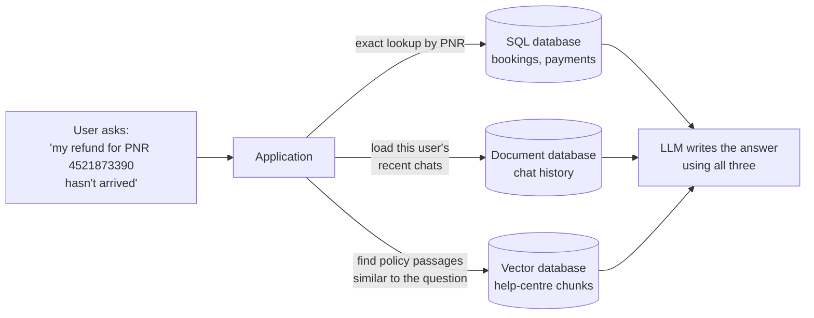
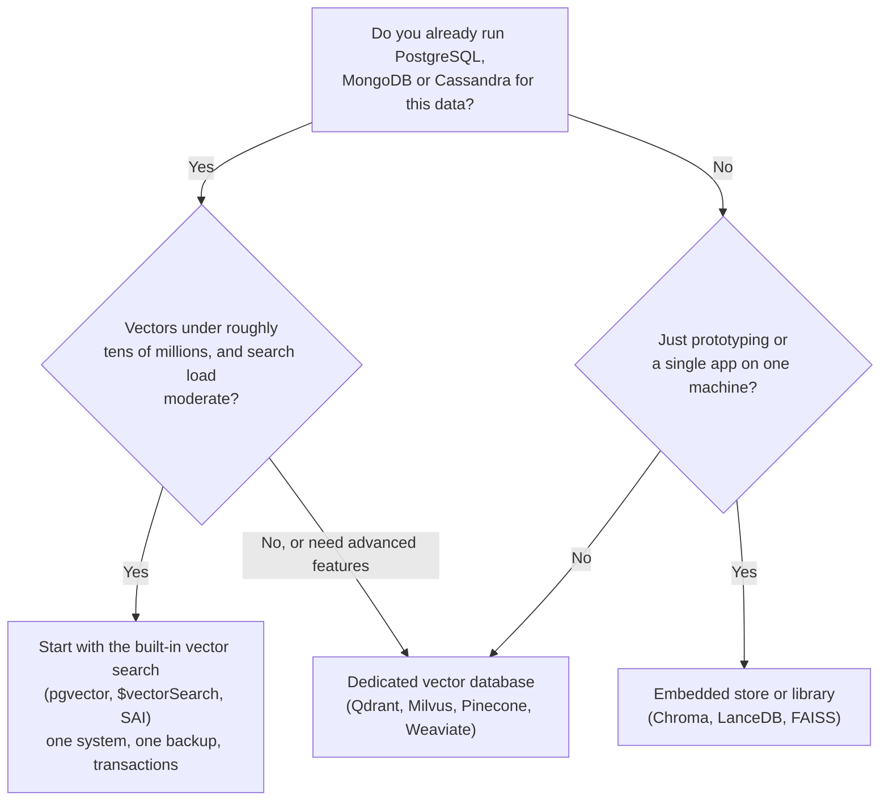

# Vector vs SQL vs NoSQL Databases: The Complete Guide

> 📚 **Before you start**
>
> - [Embeddings and Similarity Search](embeddings-and-similarity-search.md), for embeddings, cosine similarity and the cost of brute-force search.
> - [Semantic Search Explained](semantic-search-explained.md), for the indexing and query pipelines.
> - [Databases: SQL and NoSQL › Relational Databases and SQL](../../databases-sql-and-nosql/course.md#m2) and [NoSQL with MongoDB Atlas](../../databases-sql-and-nosql/course.md#m4), for tables, SQL queries, B-tree indexes and document databases.

## Introduction

Think of three counters at a big railway station.

The **reservation counter** works from a strict ledger: train 12951, coach B2, seat 34, passenger name, fare paid. Every question it answers is exact: *"Is seat 34 free on Friday?"* Yes or no. That is a **relational (SQL) database**.

The **parcel office** takes packages of every shape. One parcel has a long address and a fragile sticker, another has a phone number and nothing else. It finds a parcel by its tracking number in a second. That is a **NoSQL document or key-value database**.

The **enquiry counter** gets questions like *"I want a train that's like the Rajdhani but cheaper and leaves in the evening."* There is no exact answer. The clerk thinks of trains **similar** to what you described and suggests the closest few. That is a **vector database**.

All three are databases: they store data safely and answer questions about it. They differ in the **kind of question** they are built to answer quickly. By the end of this lesson you will be able to:

- name the question each kind of database is optimised for;
- explain why a normal database index cannot speed up similarity search;
- store and search embeddings inside SQLite (and see why it is a full scan);
- describe what a record in a vector database looks like;
- decide between a dedicated vector database and vector search added to PostgreSQL, MongoDB or Cassandra.

> 💡 **Key Insight**
>
> SQL and NoSQL databases answer **exact** questions: *which rows match this condition?* Vector databases answer **ranked, approximate** questions: *which items are closest to this one?* The difference is not the storage; it is the **index**. A B-tree sorts values along one line, and closeness in 768 dimensions cannot be sorted along one line.

---

## Core Explanation

### 1. Three kinds of question

| | Relational (SQL) | NoSQL (document, key-value, wide-column) | Vector |
|---|---|---|---|
| **Typical question** | "Orders over ₹500 from Pune in March, with the customer's name" | "Get the profile for user 8812" or "all events for device X today" | "The 10 support articles most similar to this complaint" |
| **Answer type** | Exact set of rows | Exact document(s) | Ranked list, best first, usually approximate |
| **Data shape** | Fixed tables and columns, relationships between tables | Flexible JSON documents or key → value | Fixed-length float vectors plus metadata |
| **Main index** | B-tree on columns | B-tree or hash on keys and fields; partition keys | ANN index: HNSW, IVF, PQ |
| **Strengths** | Joins, transactions, constraints, ad-hoc analytics | Flexible schema, horizontal scale, fast key lookups | Meaning-based search over unstructured data |
| **Examples** | PostgreSQL, MySQL, SQLite | MongoDB, DynamoDB, Redis, Cassandra | Qdrant, Pinecone, Milvus, Weaviate, Chroma, LanceDB |

The three are not rivals. Most real AI applications use **two or three of them together**: user accounts and payments in PostgreSQL, chat history in MongoDB, document chunks in a vector store, all tied together by shared ids.



### 2. Two query shapes: filter vs rank

A SQL query **filters**. Each row either satisfies `WHERE fare < 1500 AND source = 'Mumbai'` or it does not. The answer is a set, and it is the same every time.

A vector query **ranks**. Every stored vector has *some* similarity to the query; the database returns the top k. There is no "match" or "no match", only "closer" and "further". The answer is a list, and with an approximate index it can differ very slightly from the exact top k.

Most real searches need **both**: "the 5 most similar help articles, **but only** in Hindi and only for the payments product". That combination, **filtered vector search**, is one of the hardest parts of building a vector database, and you will see how databases handle it in [Storage and Indexing (HNSW, IVF)](../course.md#m3).

### 3. You *can* store vectors in SQL

There is nothing magic about storing a vector. It is just an array of floats, and any database can store bytes. Let's put embeddings into SQLite (the database built into Python), register a cosine similarity function, and search with plain SQL.

```python
import sqlite3
import numpy as np

rng = np.random.default_rng(7)

articles = [
    ("How to get a refund for a cancelled train ticket", "payments", "en"),
    ("UPI payment failed but money was debited", "payments", "en"),
    ("Train running late: check live status", "travel", "en"),
    ("Tatkal booking rules and timings", "travel", "en"),
    ("रद्द टिकट का रिफंड कैसे पाएं", "payments", "hi"),
    ("Change your registered mobile number", "account", "en"),
]

# Pretend embeddings: 8 dimensions, unit length. Article 4 is a Hindi version of
# article 0, so we place it close to article 0 the way a multilingual model would.
vectors = rng.normal(size=(len(articles), 8))
vectors[4] = vectors[0] + rng.normal(scale=0.2, size=8)
vectors /= np.linalg.norm(vectors, axis=1, keepdims=True)
vectors = vectors.astype(np.float32)

db = sqlite3.connect(":memory:")
db.execute("CREATE TABLE articles (id INTEGER PRIMARY KEY, title TEXT, product TEXT, lang TEXT, embedding BLOB)")
db.executemany(
    "INSERT INTO articles (id, title, product, lang, embedding) VALUES (?, ?, ?, ?, ?)",
    [(i, t, p, l, v.tobytes()) for i, ((t, p, l), v) in enumerate(zip(articles, vectors))],
)

def cosine_sql(blob_a, blob_b):
    a, b = np.frombuffer(blob_a, dtype=np.float32), np.frombuffer(blob_b, dtype=np.float32)
    return float(a @ b / (np.linalg.norm(a) * np.linalg.norm(b)))

db.create_function("cosine", 2, cosine_sql)

row = db.execute("SELECT id, title, length(embedding) FROM articles WHERE id = 0").fetchone()
print("stored:", row[1], "| bytes in the embedding column:", row[2])
```

Output:

```
stored: How to get a refund for a cancelled train ticket | bytes in the embedding column: 32
```

Each 8-dimension float32 vector takes 32 bytes, stored as a `BLOB` (binary large object) column next to ordinary columns. Now a query: "articles similar to article 0, but only in the payments product". This uses an ordinary `WHERE` filter and the custom `cosine` function in `ORDER BY`:

```python
query_vec = vectors[0].tobytes()      # "more like article 0"
rows = db.execute("""
    SELECT id, title, lang, round(cosine(embedding, ?), 3) AS score
    FROM articles
    WHERE product = 'payments' AND id != 0
    ORDER BY score DESC
    LIMIT 2
""", (query_vec,)).fetchall()
for r in rows:
    print(r)
```

Output:

```
(4, 'रद्द टिकट का रिफंड कैसे पाएं', 'hi', 0.973)
(1, 'UPI payment failed but money was debited', 'en', 0.383)
```

It works, and it found the Hindi version of the refund article first, because we placed its vector close to the English one (as a real multilingual embedding model would). But look at what SQLite had to do:

```python
for line in db.execute("EXPLAIN QUERY PLAN SELECT id FROM articles ORDER BY cosine(embedding, ?) DESC LIMIT 2",
                       (query_vec,)):
    print(line[-1])
```

Output:

```
SCAN articles
USE TEMP B-TREE FOR ORDER BY
```

`SCAN articles` means **read every row**, and `USE TEMP B-TREE FOR ORDER BY` means **compute the score for every row, then sort**. This is the brute-force search from [Embeddings and Similarity Search](embeddings-and-similarity-search.md), just written in SQL. With six rows that is nothing; with ten million it is the reason vector databases exist.

### 4. Why a normal index cannot help

A database index is a shortcut that avoids scanning every row. The standard one, the **B-tree**, keeps values **sorted**, like names in a phone book. To find fares under ₹1,500 it jumps to the right spot and reads forward. Sorting works because fares sit on one line: every fare is either smaller or larger than another.

Vectors have no such order. Is `[0.2, 0.9]` "bigger" than `[0.8, 0.1]`? The question makes no sense. You could sort by the first dimension, but two vectors with nearly equal first numbers can be far apart in all the other dimensions. Closeness in many dimensions cannot be captured by any single sorted list.

High dimensions make it worse in a second, stranger way. As the number of dimensions grows, the distances from a query to **all** points become more and more alike. This is part of what is called the **curse of dimensionality**. Watch the gap between the nearest and the farthest point shrink:

```python
rng = np.random.default_rng(0)
print(f"{'dims':>5}  {'nearest':>8}  {'farthest':>8}  {'farthest / nearest':>18}")
for d in [2, 10, 100, 1000]:
    points = rng.random((5000, d))
    query = rng.random(d)
    dist = np.linalg.norm(points - query, axis=1)
    print(f"{d:>5}  {dist.min():8.2f}  {dist.max():8.2f}  {dist.max() / dist.min():18.2f}")
```

Output:

```
 dims   nearest  farthest  farthest / nearest
    2      0.00      1.10              664.26
   10      0.49      2.16                4.40
  100      3.40      5.09                1.50
 1000     12.19     13.86                1.14
```

In 2 dimensions the farthest point is many times further away than the nearest, so it is easy to rule out most points quickly. In 1,000 dimensions every point is roughly the same distance away, so simple tricks that "rule out far regions" (which work well for maps in 2-D, like finding the nearest petrol pump) stop paying off.

Real embeddings are not uniformly random. They cluster around topics, so their structure is much friendlier than this worst case. **ANN indexes exploit that structure**: IVF groups vectors into clusters and only searches the nearest clusters; HNSW builds a graph that links each vector to its neighbours and walks it. Both give up a tiny bit of exactness for enormous speed. That is the subject of [Storage and Indexing (HNSW, IVF)](../course.md#m3).

### 5. What a record in a vector database looks like

Every vector database stores roughly the same four things per item. Names differ by product (Qdrant calls metadata the **payload**, Pinecone calls it **metadata** or **fields**, Chroma keeps **documents** and **metadatas** separately), but the shape is the same:

```json
{
  "id": "help-article-0417#chunk-3",
  "vector": [0.0213, -0.0457, 0.1138, -0.0026, "... 380 more floats ..."],
  "metadata": {
    "product": "payments",
    "lang": "hi",
    "updated_at": "2026-09-14",
    "source_url": "https://example.com/help/refunds"
  },
  "text": "रद्द टिकट का रिफंड 5 से 7 कार्य दिवसों में आपके खाते में जमा हो जाता है।"
}
```

| Part | What it is for |
|---|---|
| **id** | A unique key, so you can update or delete this item later. Often encodes the source document and chunk number. |
| **vector** | The embedding. All vectors in one collection have the same dimension and come from the same model. |
| **metadata** | Ordinary fields for **filtering** (language, product, date, user, access rights) and for showing results. |
| **text** | The original chunk, so the result can be shown to a user or passed to an LLM without a second lookup. |

Groups of records are called a **collection** (Chroma, Qdrant), an **index** (Pinecone, FAISS) or a **table** (LanceDB, PostgreSQL). Within one collection, the dimension and the distance metric are fixed when it is created.

### 6. Vector search inside databases you already run

Because vectors are just arrays, most mainstream databases have added vector types and ANN indexes. Facts below are from each project's documentation as of October 2026:

| Database | How vectors are added | Index types |
|---|---|---|
| **PostgreSQL + pgvector** (extension, v0.8.7) | `vector(n)` column type; operators `<->` (L2 distance), `<=>` (cosine distance), `<#>` (negative inner product) | HNSW and IVFFlat; indexes support up to 2,000 dimensions for `vector` and 4,000 for `halfvec` |
| **MongoDB** | Embeddings stored as arrays in documents; `$vectorSearch` aggregation stage | ANN (HNSW-based) or exact (`exact: true`); available on Atlas, and generally available for self-managed Community Edition since June 2026 via the `mongot` search process |
| **Apache Cassandra** (5.0+) | `VECTOR<FLOAT, n>` column type; `ORDER BY ... ANN OF ... LIMIT k` | Storage-Attached Index (SAI) with cosine, euclidean or dot product similarity |
| **Redis, Elasticsearch, OpenSearch** | Vector fields alongside their existing data types | HNSW (and flat), plus their own keyword search |

Here is what pgvector looks like, so you can see how little changes from ordinary SQL:

```sql
CREATE EXTENSION IF NOT EXISTS vector;

CREATE TABLE articles (
    id        bigserial PRIMARY KEY,
    title     text,
    product   text,
    embedding vector(384)
);

CREATE INDEX ON articles USING hnsw (embedding vector_cosine_ops);

-- 5 nearest payments articles to a query vector, by cosine distance
SELECT id, title, 1 - (embedding <=> $1) AS cosine_similarity
FROM articles
WHERE product = 'payments'
ORDER BY embedding <=> $1
LIMIT 5;
```

Example output:

```
 id |                      title                       | cosine_similarity
----+--------------------------------------------------+-------------------
  1 | UPI payment failed but money was debited         |              0.83
  4 | Refund timelines for cancelled tickets           |              0.79
...
```

The `ORDER BY embedding <=> $1 LIMIT 5` pattern is what lets PostgreSQL use the HNSW index instead of scanning. MongoDB and Cassandra are covered hands-on in [Vector Search in MongoDB and Cassandra](../course.md#m5).

### 7. Dedicated vector database or vector search in your existing database?



| Choose... | When |
|---|---|
| **Vector search in your existing database** | Your data already lives there; you want vectors and business data updated together in one transaction; you want one system to back up, secure and monitor; scale is moderate. |
| **A dedicated vector database** | Vectors are the main workload; you need very large scale, high query rates, advanced filtering, quantization, hybrid or multi-vector search, or multi-tenant isolation at scale. |
| **An embedded store or library** | Prototypes, notebooks, desktop and edge apps, batch jobs, or a single service where data fits on one machine. |

There is no single right answer, and teams often move between these as they grow. The thing to avoid is running a dedicated vector database for 20,000 vectors that would have fitted comfortably in a PostgreSQL table you already back up every night.

### 8. What vector databases add beyond the index

A vector *index* (like FAISS) only finds nearest neighbours in memory. A vector *database* wraps that index in everything you expect from a database:

| Capability | Why it matters |
|---|---|
| **Persistence and recovery** | Data survives restarts and crashes, usually through a write-ahead log (WAL) |
| **CRUD by id** | Insert, update and delete single items without rebuilding the whole index |
| **Metadata filtering** | "Similar, but only `lang = hi` and `product = payments`" |
| **Scaling** | Sharding across machines, replication for availability |
| **Multi-tenancy and access control** | Each customer only sees their own vectors |
| **Hybrid search** | Keyword and vector scores combined in one query |
| **Quantization and tiered storage** | Fitting billions of vectors into affordable memory and disk |

The difference between a vector **library**, an embedded vector **store**, and a vector **database server** is the subject of [In-Memory, On-Disk and Cloud Vector DBs](../course.md#m3).

---

## Try It Yourself

1. **Filter first or search first?** Using the SQLite table, find the single most similar article to article 1 among **English** articles only. Then find the most similar article overall. Are they the same?
2. **Count the work.** Modify `cosine_sql` to count how many times it is called, then run the payments query again. How many rows were scored, and why?
3. **Curse of dimensionality, but clustered.** Repeat the nearest/farthest experiment with 1,000 dimensions, but generate the 5,000 points as 10 tight clusters (10 random centres plus small noise) and use one of the centres plus noise as the query. What happens to the ratio?

<details>
<summary>Show answers</summary>

**1.**

```python
q1 = vectors[1].tobytes()
english = db.execute("SELECT title FROM articles WHERE lang = 'en' AND id != 1 "
                     "ORDER BY cosine(embedding, ?) DESC LIMIT 1", (q1,)).fetchone()
overall = db.execute("SELECT title FROM articles WHERE id != 1 "
                     "ORDER BY cosine(embedding, ?) DESC LIMIT 1", (q1,)).fetchone()
print("English only:", english[0])
print("Overall:     ", overall[0])
```

Output:

```
English only: How to get a refund for a cancelled train ticket
Overall:      How to get a refund for a cancelled train ticket
```

Here they happen to match, because the nearest article to article 1 is already in English. Change the filter to `lang = 'hi'` and the answer is forced to be the Hindi article whether or not it is close. The important point is that the filter changes which rows are even considered, so the "top 1" is a different question with a possibly different answer. Vector databases face the same question at scale: filter before the ANN search (pre-filtering) or after it (post-filtering).

**2.**

```python
calls = {"n": 0}
def counting_cosine(a, b):
    calls["n"] += 1
    return cosine_sql(a, b)

db.create_function("cosine", 2, counting_cosine)
db.execute("SELECT id FROM articles WHERE product = 'payments' AND id != 0 "
           "ORDER BY cosine(embedding, ?) DESC LIMIT 2", (vectors[0].tobytes(),)).fetchall()
print("rows scored:", calls["n"])
db.create_function("cosine", 2, cosine_sql)      # restore the plain version
```

Output:

```
rows scored: 2
```

Every row that passes the `WHERE` filter is scored, because SQLite has no index that can predict which rows are most similar. Without the filter, all six rows would be scored. In a database with millions of rows, that is millions of cosine computations per query.

**3.**

```python
rng = np.random.default_rng(1)
centres = rng.random((10, 1000))
points = centres[rng.integers(0, 10, 5000)] + rng.normal(scale=0.05, size=(5000, 1000))
query = centres[3] + rng.normal(scale=0.05, size=1000)
dist = np.linalg.norm(points - query, axis=1)
print(f"nearest {dist.min():.2f}  farthest {dist.max():.2f}  ratio {dist.max() / dist.min():.2f}")
```

Output:

```
nearest 2.07  farthest 13.60  ratio 6.58
```

With clustered data the ratio is large again: points in the query's own cluster are much closer than points in other clusters. Real embeddings behave more like this than like uniform random noise, which is exactly why cluster-based indexes such as IVF work in practice.

</details>

---

## Real-World Examples

- **Supabase and Neon** (hosted PostgreSQL providers) ship pgvector, so many startups keep users, billing and embeddings in one PostgreSQL database.
- **E-commerce platforms** keep the product catalogue in a relational or document database and the product embeddings in a vector store, joined by product id for "similar items".
- **Chat applications** store conversation history in a document database such as MongoDB and long-term memories as embeddings, often in the same MongoDB cluster using `$vectorSearch`.
- **Large-scale recommendation systems** use dedicated vector databases or libraries at the scale of billions of vectors, where sharding, quantization and tuning matter most.

---

## Common Misconceptions

### "A vector database replaces my main database"

It rarely does. Vector databases are not built for joins, multi-table transactions or financial records. They sit next to your main database and hold the embeddings.

### "Vector search needs a special database"

Not anymore. PostgreSQL, MongoDB, Cassandra, Redis and Elasticsearch all offer vector search. Dedicated vector databases win at large scale and on advanced features, not on basic capability.

### "Storing vectors in a SQL table means I have vector search"

Storing is easy; **searching fast** needs an ANN index. Without one, every query scans every row, as the `EXPLAIN QUERY PLAN` above showed.

### "Vector databases give exact answers like SQL does"

With an ANN index they return an approximate top k. That is usually fine for search and RAG, but it is a real difference. Most systems let you request exact search when you need it, at a higher cost.

---

## Interview Relevance

*"Why can't you just use PostgreSQL for vector search?"* A strong answer: you can, with pgvector, which adds a vector type and HNSW and IVFFlat indexes. A B-tree cannot help because high-dimensional closeness has no single sort order. Dedicated vector databases make sense at large scale or when you need advanced filtering, quantization, hybrid search or multi-tenancy; otherwise, keeping vectors next to the business data simplifies consistency and operations.

*"What is the difference between a vector index and a vector database?"* An index (FAISS, a single HNSW graph) only answers nearest-neighbour queries in memory. A database adds persistence, CRUD by id, metadata filtering, replication, sharding, access control and backups.

*"Explain the curse of dimensionality in the context of search."* In high dimensions, distances between random points concentrate, so space-partitioning tricks that work in 2-D (like k-d trees) lose their power. Real embeddings are clustered and lie near lower-dimensional structure, which is what ANN indexes exploit.

---

## Key Takeaways

- **SQL and NoSQL answer exact questions; vector databases answer ranked similarity questions.** Real applications usually combine them.
- **Any database can store vectors**, but without an ANN index, similarity search is a full scan.
- **B-trees cannot index closeness in many dimensions**, and the curse of dimensionality defeats simple space partitioning; ANN indexes exploit the clustered structure of real embeddings instead.
- **A vector record is id + vector + metadata + text**, and metadata filters are as important as the vector.
- **Start with vector search in the database you already run** unless scale or features demand a dedicated vector database.

---

**Up next:** [Storage and Indexing (HNSW, IVF)](../course.md#m3)
