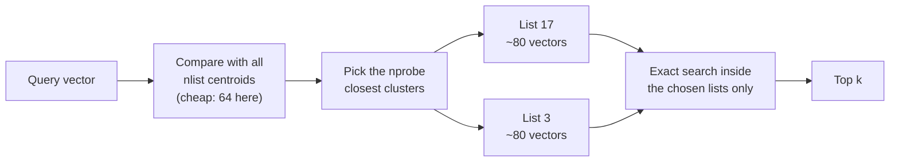
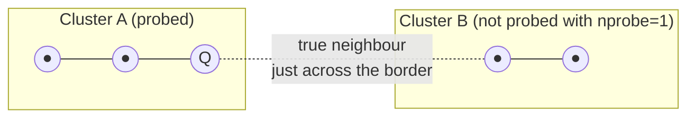
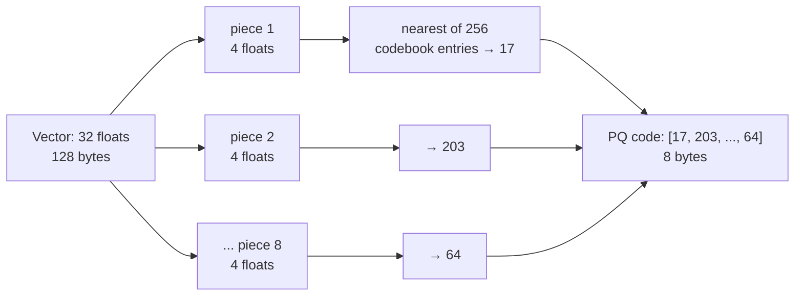

# Storage and Indexing (HNSW, IVF): The Complete Guide

> 📚 **Before you start**
>
> - [Embeddings and Similarity Search](../02-introduction-to-vector-databases/embeddings-and-similarity-search.md), for cosine similarity, brute-force kNN and recall@k.
> - [Vector vs SQL vs NoSQL Databases](../02-introduction-to-vector-databases/vector-vs-sql-vs-nosql-databases.md), for why a B-tree cannot index closeness and what the curse of dimensionality does.
> - Comfort with NumPy and the idea of k-means clustering. [Ensembles and Unsupervised Learning](../../ensembles-and-unsupervised-learning/course.md) covers k-means if it is new to you; this lesson recaps it.

## Introduction

Suppose you need to find the ten people in Mumbai whose taste in films is closest to yours. Asking all twenty million residents is exact but hopeless. Two smarter strategies come to mind.

**Strategy one: go by neighbourhood.** Film lovers cluster: art-house fans around Bandra, action fans around Andheri, and so on. Work out which two or three neighbourhoods suit you best, and only ask people there. You might miss a kindred spirit who happens to live in Thane, but you will find most of your ten very quickly.

**Strategy two: ask around.** Start with anyone. Ask them, "Who do you know whose taste is closer to mine?" Go to that person and ask again. Each hop brings you closer. To make the early hops big, start with well-connected people who know folks all over the city, then switch to people who know their immediate neighbours well.

Strategy one is **IVF** (inverted file index). Strategy two is **HNSW** (hierarchical navigable small world graph). Together with **product quantization (PQ)**, which shrinks each vector to a few bytes, these are the indexes inside nearly every vector database in use today. In this lesson you will build all three in NumPy, measure their speed and accuracy against brute force, and then see how a vector database stores, updates and filters data around them.

By the end you will be able to:

- explain what "approximate nearest neighbour" means and measure it with recall@k;
- build an IVF index, and explain `nlist` and `nprobe`;
- build an HNSW index, and explain `M`, `ef_construction` and `ef_search`;
- compress vectors with scalar and product quantization and re-rank to recover accuracy;
- explain how a vector database stores data (WAL, segments, deletes) and how filtering interacts with an ANN index;
- choose an index for a given size, memory budget and accuracy target.

> 💡 **Key Insight**
>
> Every ANN index makes the same bargain: **examine a small, well-chosen fraction of the vectors instead of all of them**, and accept that occasionally a true neighbour is missed. IVF chooses that fraction by **clusters**, HNSW by **walking a graph**, and PQ makes each examination cheaper by **compressing** the vectors. Each has one main knob that trades speed for recall, and tuning means turning that knob while watching recall.

---

## Core Explanation

### 1. The three-way trade-off

Every index sits somewhere in a triangle with three corners:

| Corner | Measured as |
|---|---|
| **Accuracy** | recall@k against exact brute-force results |
| **Speed** | latency per query, or queries per second; here we count **distance computations** per query, which is what latency mostly depends on |
| **Memory** | bytes per vector, including the index's own structures |

There is also **build time** (how long it takes to create the index) and **update cost** (can you add and delete vectors cheaply?). No index wins on everything; that is why databases offer several.


*The four index families in one picture. Real databases combine them, for example IVF + PQ, or HNSW over quantized vectors.*

### 2. A test bench: data, ground truth and recall

Real embeddings cluster around topics, so our test data does too: 5,000 unit-length vectors in 32 dimensions, spread around 40 random "topic" centres, plus 100 queries drawn the same way. First we compute the **ground truth**, the exact top 10 for every query by brute force, so that every index can be scored against it.

```python
import heapq
import numpy as np
from sklearn.cluster import KMeans

rng = np.random.default_rng(42)
N, D, TOPICS, K = 5000, 32, 40, 10

def unit(x):
    return (x / np.linalg.norm(x, axis=-1, keepdims=True)).astype(np.float32)

topic_centres = rng.normal(size=(TOPICS, D))
data = unit(topic_centres[rng.integers(0, TOPICS, N)] + rng.normal(size=(N, D)))
queries = unit(topic_centres[rng.integers(0, TOPICS, 100)] + rng.normal(size=(100, D)))

def exact_top_k(q, k=K):
    return np.argsort(-(data @ q))[:k].tolist()   # brute force: N distance computations

truth = [set(exact_top_k(q)) for q in queries]

def recall(results):
    return float(np.mean([len(set(r) & t) / K for r, t in zip(results, truth)]))

print("data:", data.shape, data.dtype, "| bytes per vector:", data[0].nbytes)
print("brute force: recall", recall([exact_top_k(q) for q in queries]), "| distance computations per query:", N)
```

Output:

```
data: (5000, 32) float32 | bytes per vector: 128
brute force: recall 1.0 | distance computations per query: 5000
```

Brute force is our baseline: perfect recall, but 5,000 distance computations per query. Every index below tries to get close to recall 1.0 with far fewer.

### 3. IVF: search only the nearest clusters

**IVF** stands for **inverted file index**, borrowing the name from keyword search's inverted index. The idea is the "neighbourhoods" strategy from the introduction:

1. **Train:** run **k-means** clustering on the vectors to find `nlist` cluster centres (also called **centroids**). K-means repeatedly assigns each vector to its nearest centre and moves each centre to the average of its vectors, until things settle.
2. **Index:** put each vector into the **list** (bucket) of its nearest centroid.
3. **Search:** compare the query with the `nlist` centroids, pick the `nprobe` closest ones, and brute-force search **only** the vectors in those lists.



```python
class TinyIVF:
    def __init__(self, nlist=64):
        self.nlist = nlist

    def train_and_add(self, vectors):
        km = KMeans(n_clusters=self.nlist, n_init=1, random_state=0).fit(vectors)
        self.centroids = km.cluster_centers_
        self.lists = [np.where(km.labels_ == c)[0] for c in range(self.nlist)]
        self.vectors = vectors

    def search(self, q, k=K, nprobe=1):
        nearest_lists = np.argsort(-(self.centroids @ q))[:nprobe]
        candidates = np.concatenate([self.lists[c] for c in nearest_lists])
        scores = self.vectors[candidates] @ q
        work = self.nlist + len(candidates)            # centroid comparisons + vector comparisons
        return candidates[np.argsort(-scores)[:k]].tolist(), work

ivf = TinyIVF(nlist=64)
ivf.train_and_add(data)
sizes = [len(lst) for lst in ivf.lists]
print(f"{ivf.nlist} lists, sizes from {min(sizes)} to {max(sizes)} (average {np.mean(sizes):.0f})")

print(f"{'nprobe':>6} {'recall@10':>10} {'distance computations':>22}")
for nprobe in [1, 2, 4, 8, 16]:
    results = [ivf.search(q, nprobe=nprobe) for q in queries]
    print(f"{nprobe:>6} {recall([r for r, _ in results]):>10.3f} {np.mean([w for _, w in results]):>22.0f}")
```

Output:

```
64 lists, sizes from 7 to 140 (average 78)
nprobe  recall@10  distance computations
     1      0.824                    161
     2      0.946                    225
     4      0.984                    365
     8      0.996                    672
    16      0.999                   1296
```

Read the table row by row. With `nprobe=1`, IVF scans about 160 vectors instead of 5,000 (31 times less work) and already finds 82 percent of the true top 10. With `nprobe=4` it finds 98 percent while still doing less than a tenth of the work of brute force. Every doubling of `nprobe` roughly doubles the work and closes part of the remaining gap. This curve, recall rising quickly and then flattening while cost keeps climbing, is the shape you will see for every index knob.

Notice also that the lists are uneven (7 to 140 vectors). K-means follows the data, so dense topics get big lists. A query landing in a big list costs more than one landing in a small list.

**Why does IVF miss neighbours at all?** A query near the **border** between two clusters may have true neighbours sitting just across the border, in a list we did not probe. Probing more lists fixes this, at the price of scanning more vectors.



**Choosing the knobs.**

| Knob | What it controls | Rule of thumb |
|---|---|---|
| `nlist` | number of clusters | Often around `sqrt(N)` to `4 × sqrt(N)`. pgvector's docs suggest `rows / 1000` lists up to a million rows and `sqrt(rows)` beyond. More lists means smaller lists, so each probe is cheaper but you need more probes. |
| `nprobe` | clusters searched per query | The speed/recall knob. Start around 1 to 5 percent of `nlist` and raise it until recall is good enough. |

IVF's strengths: simple, low memory overhead (just the centroids), fast to build, and it combines naturally with compression (IVF-PQ, below). Its weaknesses: it must be **trained** on representative data first, and if your data drifts (new topics appear), the clusters go stale and recall drops until you rebuild.

### 4. HNSW: walk a graph of neighbours

**HNSW** stands for **Hierarchical Navigable Small World**. It is the most widely used vector index today: Chroma, Qdrant, Weaviate, pgvector, Redis, Elasticsearch, OpenSearch and MongoDB all offer it.

Start with the bottom layer, a **navigable small world graph**: every vector is a node, linked to a handful of its nearest neighbours. To search, start at some entry node and **greedily** move to whichever linked neighbour is closest to the query, until no neighbour is closer. That alone works, but from a random start it can take many small steps to cross the space.

The **hierarchical** part fixes that, using the same idea as Mumbai's local trains. A **fast** train stops only at a few big stations, so you cover distance quickly; then you change to a **slow** train that stops everywhere, to reach your exact station. HNSW stacks several graph layers:

- **Layer 0** contains **every** vector, densely linked to near neighbours (the slow train).
- **Each higher layer** contains a random, exponentially smaller subset of vectors, with longer-range links (the fast trains).
- **Search** starts at the top layer's entry point, greedily moves as close as possible, drops down a layer, continues, and finally does a careful search on layer 0.


*Search enters at the top layer, makes big hops, and refines on the dense bottom layer, just like changing from a fast train to a slow one.*

Each new vector gets a random **level**: most get level 0 only, a few reach level 1, fewer still reach level 2, and so on. To insert it, the index searches for its nearest neighbours on each layer it belongs to and links it to them.

On layer 0 the search does not just follow one path. It keeps a **candidate list** of the best `ef` nodes found so far and keeps exploring their neighbours until no candidate can improve the list. Bigger `ef` explores more of the graph: slower, but fewer missed neighbours.

Here is a compact but real HNSW, about 60 lines. It follows the original algorithm, with one simplification noted in the comments.

```python
class TinyHNSW:
    def __init__(self, M=8, ef_construction=40, seed=0):
        self.M, self.ef_construction = M, ef_construction
        self.rng = np.random.default_rng(seed)
        self.vectors, self.levels, self.links = [], [], []   # links[node][layer] = neighbour ids
        self.entry, self.top_layer = None, -1
        self.distance_calls = 0

    def distance(self, node, q):
        self.distance_calls += 1
        diff = self.vectors[node] - q
        return float(diff @ diff)                  # squared L2; same ranking as cosine on unit vectors

    def search_layer(self, q, entry, ef, layer):
        """Best-first search on one layer, keeping the ef closest nodes found."""
        d = self.distance(entry, q)
        visited = {entry}
        candidates = [(d, entry)]                 # min-heap: closest unexplored node first
        best = [(-d, entry)]                      # max-heap (negated): the ef best so far
        while candidates:
            d, node = heapq.heappop(candidates)
            if d > -best[0][0]:                   # closest candidate is worse than our worst kept result
                break
            for nb in self.links[node][layer]:
                if nb in visited:
                    continue
                visited.add(nb)
                dn = self.distance(nb, q)
                if len(best) < ef or dn < -best[0][0]:
                    heapq.heappush(candidates, (dn, nb))
                    heapq.heappush(best, (-dn, nb))
                    if len(best) > ef:
                        heapq.heappop(best)
        return sorted((-negd, n) for negd, n in best)

    def add(self, vec):
        node = len(self.vectors)
        self.vectors.append(vec)
        level = int(-np.log(self.rng.random()) / np.log(self.M))   # most nodes get level 0
        self.levels.append(level)
        self.links.append([[] for _ in range(level + 1)])
        if self.entry is None:
            self.entry, self.top_layer = node, level
            return
        ep = self.entry
        for layer in range(self.top_layer, level, -1):              # fast trains: greedy, ef = 1
            ep = self.search_layer(vec, ep, 1, layer)[0][1]
        for layer in range(min(level, self.top_layer), -1, -1):
            found = self.search_layer(vec, ep, self.ef_construction, layer)
            max_links = 2 * self.M if layer == 0 else self.M
            for _, nb in found[: self.M]:                           # simplification: link the M closest
                self.links[node][layer].append(nb)                  # (real HNSW uses a heuristic that
                self.links[nb][layer].append(node)                  #  also favours diverse directions)
                if len(self.links[nb][layer]) > max_links:          # prune the neighbour's list
                    base = self.vectors[nb]
                    self.links[nb][layer].sort(key=lambda x: float((self.vectors[x] - base) @ (self.vectors[x] - base)))
                    del self.links[nb][layer][max_links:]
            ep = found[0][1]
        if level > self.top_layer:
            self.entry, self.top_layer = node, level

    def search(self, q, k=K, ef=50):
        ep = self.entry
        for layer in range(self.top_layer, 0, -1):
            ep = self.search_layer(q, ep, 1, layer)[0][1]
        return [n for _, n in self.search_layer(q, ep, max(ef, k), 0)[:k]]

hnsw = TinyHNSW(M=8, ef_construction=40)
for v in data:
    hnsw.add(v)
print("nodes per layer (layer 0 first):", np.bincount(hnsw.levels)[::-1].cumsum()[::-1].tolist())

print(f"{'ef_search':>9} {'recall@10':>10} {'distance computations':>22}")
for ef in [10, 20, 40, 80]:
    hnsw.distance_calls = 0
    results = [hnsw.search(q, ef=ef) for q in queries]
    print(f"{ef:>9} {recall(results):>10.3f} {hnsw.distance_calls / len(queries):>22.0f}")
```

Output:

```
nodes per layer (layer 0 first): [5000, 651, 88, 13, 2]
ef_search  recall@10  distance computations
       10      0.731                    127
       20      0.876                    170
       40      0.916                    212
       80      0.985                    288
```

Look at the first line: the layers really do shrink exponentially (5,000 nodes on layer 0, then 651, 88, 13 and 2 at the top), like a few fast-train stations above many slow-train ones.

Then the table. With `ef_search=80`, HNSW finds 98.5 percent of the true top 10 while computing fewer than 300 distances, about one seventeenth of brute force and less than IVF needed for similar recall. With `ef_search=10` it is even cheaper but misses more than a quarter of the neighbours. Real HNSW implementations, written in C++ or Rust with the smarter neighbour-selection heuristic, do better than this teaching version; at millions of vectors the savings grow, because the number of hops grows roughly with the logarithm of N while brute force grows with N itself.

**The three HNSW knobs**, which every database exposes under slightly different names:

| Knob | Also called | What it does | Typical values |
|---|---|---|---|
| `M` | `m`, `max_neighbors` | Links per node per layer (layer 0 usually allows 2 × M). More links: better recall, more memory, slower build. | 8 to 64; 16 is a very common default |
| `ef_construction` | `ef_construct` | Candidate list size while **inserting**. Bigger builds a better-connected graph, slowly. | 64 to 400 |
| `ef_search` | `ef`, `hnsw_ef` | Candidate list size while **searching**. The speed/recall knob you tune at query time. | must be at least k; 40 to 200 is common |

For example, Chroma's documented defaults for its local HNSW index are `max_neighbors` 16, `ef_construction` 100 and `ef_search` 100, and pgvector's are `m` 16 and `ef_construction` 64, with `hnsw.ef_search` defaulting to 40.

HNSW's strengths: excellent recall at low latency, no training step, and it supports inserting vectors one at a time. Its weaknesses: **memory** (the graph links cost extra bytes per vector on top of the vectors themselves, and the graph performs best fully in RAM), slower builds than IVF, and **deletes** are awkward, because removing a node can disconnect parts of the graph. Databases usually mark deleted nodes and clean up in the background.

### 5. Compression: scalar and product quantization

Speed is half the problem; memory is the other half. A billion 768-dimension float32 vectors need about 3 TB of RAM. **Quantization** stores vectors in fewer bits.

**Scalar quantization (SQ)** stores each number as a 1-byte integer instead of a 4-byte float: work out the minimum and maximum of each dimension, and map that range onto 0 to 255. That is a 4× saving with very little loss.

```python
lo, hi = data.min(axis=0), data.max(axis=0)
codes_int8 = np.round((data - lo) / (hi - lo) * 255).astype(np.uint8)    # 1 byte per number
decoded = codes_int8.astype(np.float32) / 255 * (hi - lo) + lo

sq_results = [np.argsort(-(decoded @ q))[:K].tolist() for q in queries]
print(f"scalar quantization: {codes_int8[0].nbytes} bytes per vector (was {data[0].nbytes}), "
      f"recall@10 = {recall(sq_results):.3f}")
```

Output:

```
scalar quantization: 32 bytes per vector (was 128), recall@10 = 0.983
```

**Product quantization (PQ)** goes much further. It splits each vector into `m` equal **sub-vectors** (here 8 pieces of 4 numbers), runs k-means **separately in each piece** to learn 256 representative sub-vectors (a **codebook**), and replaces each piece with the 1-byte number of its nearest codebook entry. A 32-number vector becomes 8 bytes: a 16× saving.



To search, PQ never decodes vectors. For each query it builds a small **lookup table**: the score between each query piece and each of the 256 codebook entries (8 × 256 numbers). The approximate score of any stored vector is then just **8 table lookups added together**. This is called **asymmetric distance computation**, because the query stays exact while the stored vectors are compressed.

```python
class TinyPQ:
    def __init__(self, m=8, n_codes=256):
        self.m, self.n_codes = m, n_codes

    def train_and_encode(self, vectors):
        self.sub = vectors.shape[1] // self.m
        self.codebooks, codes = [], []
        for j in range(self.m):
            piece = vectors[:, j * self.sub:(j + 1) * self.sub]
            km = KMeans(n_clusters=self.n_codes, n_init=1, max_iter=25, random_state=0).fit(piece)
            self.codebooks.append(km.cluster_centers_)
            codes.append(km.labels_.astype(np.uint8))
        self.codes = np.stack(codes, axis=1)            # shape (N, m), one byte each

    def search(self, q, k=K):
        table = np.stack([cb @ q[j * self.sub:(j + 1) * self.sub] for j, cb in enumerate(self.codebooks)])
        approx_scores = table[np.arange(self.m), self.codes].sum(axis=1)   # m lookups per vector
        return np.argsort(-approx_scores)[:k].tolist(), approx_scores

pq = TinyPQ(m=8)
pq.train_and_encode(data)
print("PQ code for vector 0:", pq.codes[0].tolist(), f"({pq.codes[0].nbytes} bytes)")
print(f"PQ only:            recall@10 = {recall([pq.search(q)[0] for q in queries]):.3f}")

def pq_with_rerank(q, shortlist=50):
    _, approx = pq.search(q)
    candidates = np.argsort(-approx)[:shortlist]                    # cheap: compressed scores
    exact = data[candidates] @ q                                    # exact scores for 50 only
    return candidates[np.argsort(-exact)[:K]].tolist()

print(f"PQ + re-rank top 50: recall@10 = {recall([pq_with_rerank(q) for q in queries]):.3f}")
```

Output:

```
PQ code for vector 0: [246, 168, 31, 48, 135, 107, 106, 43] (8 bytes)
PQ only:            recall@10 = 0.616
PQ + re-rank top 50: recall@10 = 0.982
```

PQ on its own finds only about 62 percent of the true top 10: squeezing 128 bytes into 8 loses detail, so neighbours that are close together get shuffled. But the true neighbours are almost always **somewhere near the top** of the PQ ranking. Taking the PQ top 50 and re-scoring just those 50 with the full vectors brings recall back to 98 percent. That pattern, **compressed search for a shortlist, then exact re-ranking**, is used by almost every large vector database. The full vectors can live on cheaper disk, because only the shortlist needs them.

Production systems combine these ideas:

| Combination | How it works | Used for |
|---|---|---|
| **IVF-PQ** | IVF picks the clusters; vectors inside lists are stored as PQ codes | Very large collections that must fit in RAM; FAISS's classic billion-scale setup, and one of LanceDB's index types |
| **HNSW + scalar or binary quantization** | Graph over compressed vectors, re-rank with originals | Qdrant, Weaviate and others cut memory 4× to 32× this way |
| **Graph index on SSD** (DiskANN-style) | Compressed vectors in RAM guide a graph search whose full vectors live on fast disk | Billions of vectors per machine without terabytes of RAM |
| **Binary quantization** | 1 bit per dimension; similarity by counting matching bits | Extreme compression for high-dimensional models, almost always with re-ranking |

### 6. All three, side by side

```python
print(f"{'index':<28} {'recall@10':>9} {'distance computations':>22} {'bytes per vector':>17}")
rows = [
    ("Flat (brute force)", recall([exact_top_k(q) for q in queries]), N, data[0].nbytes),
]
results = [ivf.search(q, nprobe=4) for q in queries]
rows.append(("IVF, nlist=64, nprobe=4", recall([r for r, _ in results]),
             np.mean([w for _, w in results]), data[0].nbytes))
hnsw.distance_calls = 0
results = [hnsw.search(q, ef=40) for q in queries]
links_per_node = np.mean([len(hnsw.links[n][0]) for n in range(N)])
rows.append(("HNSW, M=8, ef_search=40", recall(results), hnsw.distance_calls / len(queries),
             data[0].nbytes + 4 * links_per_node))
rows.append(("PQ m=8, re-rank 50", recall([pq_with_rerank(q) for q in queries]), N, pq.codes[0].nbytes))
for name, r, work, size in rows:
    print(f"{name:<28} {r:>9.3f} {work:>22.0f} {size:>17.0f}")
```

Output:

```
index                        recall@10  distance computations  bytes per vector
Flat (brute force)               1.000                   5000               128
IVF, nlist=64, nprobe=4          0.984                    365               128
HNSW, M=8, ef_search=40          0.916                    212               177
PQ m=8, re-rank 50               0.982                   5000                 8
```

Each index wins on a different column. IVF and HNSW both cut the work by more than ten times; with these settings IVF reaches higher recall, and HNSW does less work (raise its `ef_search` to 80 and it reaches 0.985 for about 290 computations, as the earlier table showed). HNSW also pays memory for its graph: about 12 links per node at 4 bytes each, roughly 40 percent on top of these small 128-byte vectors (a much smaller share for real 1,536-dimension vectors). PQ with re-ranking keeps high recall in 8 bytes per vector, 16 times less memory. Its "5,000 computations" are cheap table lookups rather than full 32-dimension distance calculations, and in practice PQ is paired with IVF so that it only scans a few lists.

A practical guide to choosing:

| Situation | Good first choice |
|---|---|
| Under about 100,000 vectors, or exact answers required | **Flat** (brute force). Simple, exact, often fast enough. |
| Up to tens of millions, RAM available, frequent inserts, low latency needed | **HNSW** (the default in most vector databases) |
| Very large collection, tight memory budget, mostly batch inserts | **IVF-PQ**, or HNSW over quantized vectors |
| Billions of vectors per machine | **Disk-based graph index** with compressed vectors in RAM |

### 7. How a vector database stores data

An index is a data structure in memory. A **database** must also survive crashes, accept writes while serving reads, and handle deletes. Most vector databases use a design borrowed from other modern databases:


*The common write path and read path inside a vector database. Product names differ, but the shape is the same.*

1. **Write-ahead log (WAL).** Every insert, update and delete is first appended to a log on disk. If the server crashes, it replays the log on restart, so acknowledged writes are never lost.
2. **In-memory buffer.** New vectors land in a small, fresh segment that is searched by brute force, because building an index for a handful of vectors is not worth it. (This is why freshly inserted items are searchable immediately, just a little more slowly.)
3. **Segments.** When the buffer grows past a threshold, it is sealed into an **immutable segment** and an ANN index (HNSW or IVF) is built for it in the background. A collection is many segments.
4. **Search fans out.** A query searches every segment (each with its own index), and the results are merged into one top k.
5. **Deletes are tombstones.** Because segments are immutable, a delete just records "id 4471 is deleted" and search skips it. An **update** is a delete plus an insert.
6. **Compaction.** Background jobs merge small segments into bigger ones and physically drop deleted items, rebuilding indexes as they go.

Metadata (the payload) is stored alongside, usually with its own ordinary indexes (B-trees, hash indexes or bitmaps) so that filters such as `lang = 'hi'` are fast.

### 8. Filtering: the hard part

"Find the 10 nearest, but only where `lang = 'hi'`" sounds simple, but it collides with ANN indexes. There are three strategies:

| Strategy | How | Problem |
|---|---|---|
| **Post-filtering** | Run ANN search for the top k, then drop items that fail the filter | If the filter is selective, you may end up with **fewer than k** results, or none |
| **Pre-filtering** | Find all ids matching the filter first, then brute-force search only those | Exact, but slow when the filter matches millions of items |
| **Filtered (in-index) search** | Walk the HNSW graph or IVF lists but only **count** nodes that pass the filter, while still using the others to navigate | Best of both; what modern vector databases do, often switching to pre-filtering automatically when the filter matches only a few items |

Here is post-filtering failing on our test bench. We tag about 2 percent of vectors as Hindi and ask for the top 10 Hindi results:

```python
lang = np.where(rng.random(N) < 0.02, "hi", "en")
q = queries[0]

ann_top = hnsw.search(q, k=K, ef=40)
post = [i for i in ann_top if lang[i] == "hi"]                    # post-filter

hindi_ids = np.where(lang == "hi")[0]                              # pre-filter: exact over the subset
pre = hindi_ids[np.argsort(-(data[hindi_ids] @ q))[:K]].tolist()

print("Hindi vectors in the collection:", len(hindi_ids))
print("post-filter returned:", len(post), "results")
print("pre-filter returned: ", len(pre), "results, after scoring", len(hindi_ids), "vectors")
```

Output:

```
Hindi vectors in the collection: 89
post-filter returned: 0 results
pre-filter returned:  10 results, after scoring 89 vectors
```

Post-filtering asked HNSW for the 10 nearest vectors overall, and almost none of them were Hindi. Pre-filtering found a full 10 because it only looked at Hindi vectors, which is cheap here because there are few of them. With a filter that matches 40 percent of a hundred million vectors, pre-filtering would be far too slow, and filtered in-graph search earns its keep. When you evaluate vector databases, **test recall with your real filters**, not just without them.

---

## Try It Yourself

1. **More lists, fewer vectors per probe.** Build `TinyIVF(nlist=256)` and print recall and work for `nprobe` in 1, 4 and 16. Compare with `nlist=64` at the same amount of work.
2. **Bigger M.** Build `TinyHNSW(M=16)` and compare recall at `ef_search=20` with the `M=8` index. What did it cost?
3. **Fewer PQ pieces.** Train `TinyPQ(m=4)`. How many bytes per vector, and what recall do you get with and without re-ranking?
4. **Over-fetch to rescue post-filtering.** Ask HNSW for the top 200 with `ef=200`, then post-filter for Hindi. How many results do you get now?

<details>
<summary>Show answers</summary>

**1.**

```python
ivf256 = TinyIVF(nlist=256)
ivf256.train_and_add(data)
for nprobe in [1, 4, 16]:
    results = [ivf256.search(q, nprobe=nprobe) for q in queries]
    print(f"nlist=256 nprobe={nprobe:>2}: recall {recall([r for r, _ in results]):.3f}, "
          f"work {np.mean([w for _, w in results]):.0f}")
```

Output:

```
nlist=256 nprobe= 1: recall 0.322, work 277
nlist=256 nprobe= 4: recall 0.837, work 343
nlist=256 nprobe=16: recall 0.996, work 569
```

With 256 smaller lists, one probe scans fewer vectors, but the true neighbours are spread over more lists, so you need more probes: `nprobe=16` costs 569 computations for 0.996 recall. With 64 lists, `nprobe=8` reached the same recall for 672. The two settings are close here; on bigger collections more lists usually win, which is why the rules of thumb grow `nlist` with N.

**2.**

```python
hnsw16 = TinyHNSW(M=16, ef_construction=40)
for v in data:
    hnsw16.add(v)
for name, index in [("M=8 ", hnsw), ("M=16", hnsw16)]:
    index.distance_calls = 0
    r = recall([index.search(q, ef=20) for q in queries])
    links = np.mean([len(index.links[n][0]) for n in range(N)])
    print(f"{name}: recall {r:.3f}, work {index.distance_calls / len(queries):.0f}, "
          f"average layer-0 links {links:.1f}")
```

Output:

```
M=8 : recall 0.876, work 170, average layer-0 links 12.3
M=16: recall 0.965, work 222, average layer-0 links 25.0
```

Doubling `M` doubles the links per node (and the memory they use) and lifts recall at `ef_search=20` from 0.876 to 0.965, for about 30 percent more distance computations per query. Building also took noticeably longer. That is the classic `M` trade-off: better graph, more memory, slower build.

**3.**

```python
pq4 = TinyPQ(m=4)
pq4.train_and_encode(data)
plain = recall([pq4.search(q)[0] for q in queries])

def rerank4(q, shortlist=50):
    _, approx = pq4.search(q)
    cand = np.argsort(-approx)[:shortlist]
    return cand[np.argsort(-(data[cand] @ q))[:K]].tolist()

print(f"m=4: {pq4.codes[0].nbytes} bytes per vector, recall {plain:.3f}, "
      f"with re-rank {recall([rerank4(q) for q in queries]):.3f}")
```

Output:

```
m=4: 4 bytes per vector, recall 0.391, with re-rank 0.870
```

With only 4 bytes per vector, each code carries less information, so plain PQ recall drops to about 0.39 and even re-ranking 50 candidates only recovers 0.87: the true neighbours no longer reliably make the shortlist. You can widen the shortlist (more re-ranking work) or use more bytes per vector. Compression level and shortlist size are tuned together.

**4.**

```python
wide = hnsw.search(q, k=200, ef=200)
post_wide = [i for i in wide if lang[i] == "hi"][:K]
print("post-filter after over-fetching 200:", len(post_wide), "results;",
      "overlap with exact pre-filter answer:", len(set(post_wide) & set(pre)))
```

Output:

```
post-filter after over-fetching 200: 1 results; overlap with exact pre-filter answer: 1
```

Even after fetching 200 candidates, only one of them is Hindi, because Hindi vectors are rare and scattered. Over-fetching helps when the filter keeps a large share of the data; for rare values like this one, pre-filtering (or a database with filter-aware search that switches strategy automatically) is the right tool.

</details>

---

## Real-World Examples

- **pgvector** offers both HNSW and IVFFlat (IVF without compression). Its documentation recommends building IVFFlat only after the table has data, because the lists are trained on existing rows, which is the IVF training step you saw above.
- **FAISS**, Meta's similarity search library, implements flat, IVF, HNSW, PQ and their combinations, and is the reference implementation many databases benchmark against.
- **Qdrant** uses HNSW with filter-aware search, and offers scalar, binary and product quantization with optional re-scoring against the original vectors.
- **LanceDB** builds IVF-based indexes (IVF-PQ among them, and IVF with HNSW inside each partition) over its columnar on-disk format.
- **Chroma** uses HNSW on a single node; its documentation notes that its distributed and cloud deployments use a different index (SPANN), which is a cluster-based design for disk-resident data.

---

## Common Misconceptions

### "Approximate means unreliable"

Well-tuned ANN indexes routinely reach 95 to 99 percent recall@10. For search and RAG, missing the ninth-best passage rarely changes the answer, and the speed gain is often a hundred times or more.

### "HNSW is always the best index"

It is the best default when RAM is plentiful and latency matters. At very large scale or with tight memory, IVF-PQ or a disk-based graph index is often the better choice, and under about 100,000 vectors brute force may be simplest.

### "Higher ef_search is free"

Each increase explores more of the graph. Recall gains flatten out while latency keeps rising. Tune it against a recall target on your own queries.

### "Quantization ruins accuracy"

Quantization alone loses some recall, but re-ranking a shortlist with the original vectors recovers most of it, as the PQ example showed. Many databases do this re-scoring automatically.

### "Filtering is just a WHERE clause"

With ANN indexes, filters change which nodes the search can use. Naive post-filtering can silently return too few results. Always test your recall **with** your real filters.

---

## Interview Relevance

*"Explain HNSW."* A strong answer: a multi-layer proximity graph; each node links to about M near neighbours; upper layers are exponentially sparser and provide long-range hops; search descends greedily from the top-layer entry point, then runs a best-first search on layer 0 with a candidate list of size ef_search; M and ef_construction control graph quality, memory and build time; ef_search trades latency for recall at query time. Mention weaknesses: memory overhead and awkward deletes.

*"Explain IVF and what nprobe does."* K-means partitions the vectors into nlist clusters; each vector goes into its nearest cluster's list; a query scans only the nprobe nearest lists. Misses happen at cluster borders; raising nprobe increases recall and cost. It needs training data and can go stale as data drifts.

*"How does product quantization work, and why re-rank?"* Split vectors into m sub-vectors, learn a 256-entry codebook per sub-space, store one byte per sub-vector; search with per-query lookup tables (asymmetric distance). Compression is lossy, so fetch a shortlist with PQ scores and re-score it with full vectors.

*"How do you handle metadata filters with ANN search?"* Compare post-filtering (too few results), pre-filtering (exact but slow for broad filters) and filtered in-graph search; mention query planners that switch strategy based on how selective the filter is.

---

## Key Takeaways

- **ANN indexes examine a small, smart fraction of vectors**; measure what they miss with recall@k against brute-force ground truth.
- **IVF** clusters vectors and searches the `nprobe` nearest clusters; it is cheap and compact but needs training and misses border neighbours.
- **HNSW** walks a layered neighbour graph; `M`, `ef_construction` and `ef_search` trade memory, build time and latency for recall. It is the default in most vector databases.
- **Scalar and product quantization** shrink vectors 4× to 16× or more; re-ranking a shortlist with the original vectors recovers most of the accuracy.
- **Vector databases store data in segments** behind a write-ahead log, use tombstones for deletes and compaction to clean up, and need filter-aware search to combine metadata conditions with ANN.

---

**Up next:** [In-Memory, On-Disk and Cloud Vector DBs](in-memory-on-disk-and-cloud-vector-dbs.md)
